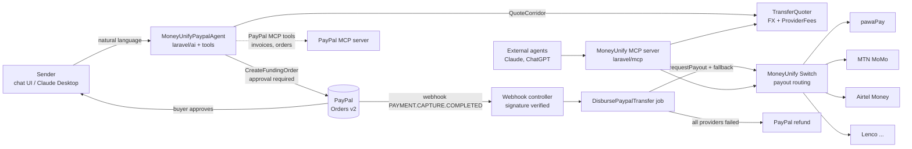

# Implementation Guide: MoneyUnify-PayPal

This guide describes what MoneyUnify-PayPal is, how it fits into the existing switch, and how each component is built and tested.

---

## 1. The product in one paragraph

**MoneyUnify-PayPal** is an AI agent that lets anyone with a PayPal account pay someone who only has mobile money. A sender in the US, UK or EU tells the agent what they want: "pay my sister's school fees in Lusaka" or "send K2,000 to my mum's Airtel number". The agent:

1. Works out the recipient and corridor.
2. Quotes the cheapest route, with fees and the FX rate shown.
3. Asks for approval, then collects in **PayPal**.
4. Uses the MoneyUnify switch to settle in local currency to **MTN, Airtel, M-Pesa or Zamtel**, falling back across providers automatically.
5. Refunds the PayPal payment if delivery fails.

Every step is guarded by spending limits and logged for audit.

---

## 2. Key decisions

| Decision | Detail |
|---|---|
| **License** | Apache-2.0 (`LICENSE.txt`, `NOTICE`). |
| **AI SDK** | [Laravel AI SDK](https://laravel.com/ai) (`laravel/ai` ^1.2). It provides agents, tools, conversation memory, human tool approval, streaming, provider failover, and fakes for testing. |
| **MCP** | `laravel/mcp` ^1.0, both as a **server** (exposing MoneyUnify tools) and as a **client** (giving our agent PayPal's MCP tools). |
| **Model** | Anthropic Claude: `claude-sonnet-5-5` by default, with failover to `claude-opus-5-5`. |
| **Sandbox first** | Development and testing run against the PayPal and pawaPay sandboxes. The simulated payout driver (§4.4) is clearly labelled wherever it appears. |

---

## 3. Architecture



Three layers, each usable on its own:

1. **Switch layer (existing, extended).** PayPal becomes a collection driver, and the switch gains **payouts** with the same fallback and cost-aware routing it already has for collections.
2. **Transfer layer (new).** A `PaypalTransfer` links a PayPal funding leg to a mobile-money payout leg. It covers quotes, the state machine, webhooks and refunds.
3. **Agent layer (new).** A Laravel AI SDK agent whose tools sit behind server-side guardrails. It can also use PayPal's MCP tools. A MoneyUnify MCP server lets *any* agent use MoneyUnify alongside PayPal's own MCP server.

All business logic lives in plain services (`TransferQuoter`, `PayoutRouter`, `PaypalTransferService`). AI tools and MCP tools are thin adapters over those services, so the agent, the MCP server, the HTTP API and the tests all exercise the same code.

---

## 4. Workstreams

### 4.1 PayPal collection driver: `PaypalController`

`app/Http/Controllers/Providers/PaypalController.php` implements `PaymentProviderInterface`. Use `DpoController` and `FlutterwaveController` as redirect-style references, and `AirtelController` for the OAuth token pattern.

- **Constants**
  - `PROVIDER_NAME = 'PayPal'` and `DEFAULT_LOGO = '/paypal.png'`.
  - `CONFIG_FIELDS`: `client_id`, `client_secret` (password), `mode` (`sandbox`/`live`), `webhook_id`.
  - `SUPPORTED_COUNTRIES`: every `Market` code, since PayPal collects from payers anywhere.
  - `FEE_SCHEDULE`: PayPal's sandbox-documented percentage plus a fixed fee, so cost-aware routing can price it.
- **Auth.** OAuth2 client credentials against `api-m.sandbox.paypal.com` or `api-m.paypal.com`. Cache the token until shortly before `expires_in`.
- **`requestPayment`**
  - `POST /v2/checkout/orders` with intent `CAPTURE`.
  - Send a `PayPal-Request-Id` header set to our `transaction_id`, for idempotency.
  - Set `return_url` and `cancel_url` to the transfer return routes.
  - Store the order id as `provider_transaction_id`.
  - Return the standard envelope **plus `checkout_url`** (the `payer-action`/`approve` link).
- **`verifyPayment`**
  - `GET /v2/checkout/orders/{id}`.
  - If the status is `APPROVED`, capture (`POST .../capture`). Map `COMPLETED` to `SUCCESS`, and `VOIDED` or declined to `FAILED`.
  - Save the capture id in `provider_response` for refunds.
- **Currency.**
  - Add an optional `currency` field to `SwitchController::requestPayment` validation. It may differ from `Market::currency()` only for drivers that declare `MULTI_CURRENCY = true`.
  - Default PayPal to `USD`.
  - Format amounts with currency-aware decimals: JPY, HUF and TWD use 0 decimals.
- **Payer identity.** For PayPal, `account_number` may be an email. Relax validation for that driver only, rather than globally.

### 4.2 PayPal webhooks

- **Route.** `POST /webhooks/paypal/{provider}` in `routes/api.php`, outside `VerifyApiAccess`. Throttle it.
- **Verification.** Call `POST /v1/notifications/verify-webhook-signature` using the provider's `webhook_id`. Reject anything not `SUCCESS`.
- **Events handled**
  - `CHECKOUT.ORDER.APPROVED`: capture, as a safety net if the return redirect never happens.
  - `PAYMENT.CAPTURE.COMPLETED`: mark the funding transaction `SUCCESS`, then dispatch `DisbursePaypalTransfer`.
  - `PAYMENT.CAPTURE.DENIED`, `PAYMENT.CAPTURE.REFUNDED`: update state.
- **Idempotency.** Store processed webhook event ids so retries are no-ops.

### 4.3 Payouts in the switch (new capability)

Every driver today is collection-only (`direction = 'credit'`). The `transactions.direction` column already allows `debit`.

- New `app/Contracts/PayoutProviderInterface.php`:
  - `requestPayout(Transaction $transaction, array $recipient): JsonResponse`
  - `verifyPayout(Transaction $transaction): JsonResponse`
- Implement it first on **pawaPay**, which has a public sandbox with payouts across about 20 markets. Then add MTN MoMo Disbursement and Airtel Money if time allows.
- `PayoutRouter` reuses the collection routing:
  1. Filter by country.
  2. Apply cost-aware ordering.
  3. Fall back sequentially.
  4. Use the same "no time bound" rule to avoid double payouts.

  Extract the shared loop from `SwitchController` into a reusable router, rather than copying it.
- New public API: `POST /api/v1/payout/request` and `POST /api/v1/payout/verify`, with docs in `prezet/content/api/`.
- **Coverage.** `Coverage` reports payout-capable providers separately, so the landing page shows "collect in X / pay out in Y".

### 4.4 Simulated payout driver

`SandboxPayoutController` implements `PayoutProviderInterface`. It succeeds or fails based on the MSISDN suffix (`...0000` fails, everything else succeeds after a short delay). It's labelled **"Simulated"** in the dashboard and only registers when `APP_ENV != production`. This makes the **fallback and refund** paths reproducible end to end, without depending on a third-party sandbox.

### 4.5 PayPal transfers

**Migration and model: `PaypalTransfer`** (`php artisan make:model PaypalTransfer -mf`)

| Column | Notes |
|---|---|
| `id` (uuid), `user_id` | Owner, the merchant/operator instance. |
| `sender_email`, `sender_name` | PayPal payer. |
| `recipient_name`, `recipient_msisdn`, `recipient_country`, `recipient_network` | Mobile-money recipient. |
| `purpose` | Free text or enum: school fees, groceries, family support, invoice. |
| `funding_amount`, `funding_currency` | PayPal leg, e.g. USD. |
| `payout_amount`, `payout_currency` | Mobile-money leg, e.g. ZMW. |
| `fx_rate`, `fee_total`, `quote_expires_at` | Locked quote. |
| `status` | Enum `PaypalTransferStatus`: `quoted`, `awaiting_approval`, `funded`, `paying_out`, `delivered`, `refunding`, `refunded`, `failed`. |
| `funding_transaction_id`, `payout_transaction_id` | FKs to `transactions`, with `direction` credit and debit. |
| `conversation_id` | The Laravel AI SDK conversation (`agent_conversations.id`) that created the transfer, for audit. |

**State machine.** Allowed transitions live in the enum. Every transition is written to a `paypal_transfer_events` table, which drives the timeline UI.

```
quoted → awaiting_approval → funded → paying_out → delivered
                    ↘ failed (expired / cancelled)      ↘ refunding → refunded
```

**Services**

- **`FxQuote`**: rates come from a configurable source. A static table in `config/moneyunify_paypal.php` for the sandbox, with an optional live API. The quote locks for 10 minutes and sets `is_fx` and `fx_rate` on both transactions.
- **`TransferQuoter`**: combines the FX rate with the PayPal fee and the cheapest payout provider's fee (`ProviderFees`) to give an all-in quote. It returns "recipient gets X" and "you pay Y".
- **`DisbursePaypalTransfer`** job: calls the `PayoutRouter`. If every provider fails, it refunds the PayPal capture (`POST /v2/payments/captures/{id}/refund`) and marks the transfer `refunded`. It notifies both parties.

### 4.6 The AI agent (Laravel AI SDK)

Install once: `php artisan vendor:publish --provider="Laravel\Ai\AiServiceProvider"` then `php artisan migrate`. This creates `agent_conversations` and `agent_conversation_messages`. Set `ANTHROPIC_API_KEY` in `.env`.

**Agent:** `php artisan make:agent MoneyUnifyPaypalAgent` → `app/Ai/Agents/MoneyUnifyPaypalAgent.php`

```php
#[Provider(Lab::Anthropic)]
#[Model('claude-sonnet-5-5')]
#[MaxSteps(10)]
#[Timeout(120)]
class MoneyUnifyPaypalAgent implements Agent, Conversational, HasTools
{
    use Promptable, RemembersConversations;

    public function instructions(): Stringable|string { /* role, corridors, guardrail explanations */ }

    public function tools(): iterable
    {
        return [
            new ListCorridors,
            new ResolveRecipient,
            new QuoteCorridor,
            (new CreateFundingOrder)->requireApproval('Confirm the amount and recipient before PayPal checkout.'),
            new GetTransferStatus,
            new CancelTransfer,
            new ExplainRouting,
            ...Mcp::client('paypal')->tools(), // PayPal's MCP server (invoices, orders) via the Laravel MCP client
        ];
    }
}
```

- **Conversation memory.** `RemembersConversations` plus `HasConversations` on `User`. Start a chat with `->forUser($user)->prompt(...)`. Resume with `->continue($conversationId, as: $user)`, after checking the conversation belongs to the user.
- **Streaming to the React UI.** `->stream($message)->usingVercelDataProtocol()` from a controller route, which the chat pane consumes.
- **Failover.** Pass `[Lab::Anthropic => 'claude-sonnet-5-5', ...]` style provider/model lists so rate limits or overloads fail over instead of erroring.
- **PayPal MCP client.** Configure a named `paypal` client in the Laravel MCP config, pointing at PayPal's remote MCP server and authenticated with the sandbox access token from the PayPal provider config. The agent can then also create PayPal invoices or look up orders natively.

**Tools:** `php artisan make:tool <Name>` → `app/Ai/Tools/`. Each tool implements `Laravel\Ai\Contracts\Tool` (`description()`, `schema(JsonSchema $schema)`, `handle(Request $request)`) and is a thin wrapper over the services above.

| Tool | What it does | Side effects |
|---|---|---|
| `ListCorridors` | Countries and networks we can pay out to | none |
| `ResolveRecipient` | Normalises an MSISDN, detects the country and network, and returns a masked name if the provider supports lookup | none |
| `QuoteCorridor` | All-in quote: fees, FX, cheapest route and fallbacks | creates a `quoted` transfer |
| `CreateFundingOrder` | Creates the PayPal order and returns the approval link | moves the transfer to `awaiting_approval`; **`Approvable`** |
| `GetTransferStatus` | Reads the transfer timeline | none |
| `CancelTransfer` | Cancels before funding | state change |
| `ExplainRouting` | Explains in plain English why provider A was chosen over B, using the logs | none |

**Guardrails.** These are enforced in code, not in the prompt.

- **Two human approvals before money moves.**
  1. `CreateFundingOrder` implements `Approvable` (with `InteractsWithApprovals`). The agent run pauses (`$response->hasPendingApprovals()`), and the UI shows the pending call's amount, recipient and reason. The sender's choice resumes it with `Decisions::from([$callId => Decision::approve()])` or `Decision::reject('...')`.
  2. The sender then approves the payment itself on PayPal's own checkout.
- **Spending limits.** A per-sender cap per transaction and per day in `config/moneyunify_paypal.php`. `needsApproval()` and `handle()` both refuse amounts above the cap with a structured error, and the agent explains the refusal.
- **Recipient confirmation.** First-time recipients always require approval, with the reason "new recipient". Repeat recipients under the cap still need approval, but carry a lighter reason.
- **Quote expiry.** Funding must happen before `quote_expires_at`, so FX risk stays bounded.
- **Audit.** Tool calls and results are persisted in the SDK's conversation tables and linked to the transfer by `conversation_id`. They are shown in the transfer timeline.
- **Prompt-injection hygiene.** Recipient names and free-text fields are treated as data. Tool outputs never include instructions.

**Where the AI adds real value:**

1. Turning messy intent into a precise transfer: "my mum in Kitwe, the Airtel number I used last time, about $50".
2. Explaining cost trade-offs in plain language: "MTN via pawaPay is 1.2% cheaper than Airtel today".
3. Proactive recovery: "the first provider timed out, I rerouted through Lenco, delivered in 40s".
4. Merchant-side **Ask your payments**: "why did payouts to Uganda fail yesterday?". This uses a second, read-only agent (`PaymentsAnalystAgent`) over `transactions` and `provider_logs`, with structured output (`HasStructuredOutput`) for tables and charts.

### 4.7 MoneyUnify MCP server (`laravel/mcp`)

- `php artisan make:mcp-server MoneyUnifyServer`, plus one `php artisan make:mcp-tool` per capability. The capabilities are `list_corridors`, `quote_corridor`, `request_payment`, `verify_payment`, `request_payout` and `get_transfer_status`. Each MCP tool calls the same services as the AI tools.
- Register it in `routes/ai.php`: `Mcp::web('/mcp/moneyunify', MoneyUnifyServer::class)`, behind `auth:sanctum` so it uses the existing API token.
- **Example:** in Claude Desktop, connect **PayPal's MCP server** and **MoneyUnify's MCP server** side by side. Ask, for example, "invoice my client in PayPal, and when it's paid, send 60% to my supplier's M-Pesa." The agent combines both servers. MoneyUnify extends PayPal's agent ecosystem rather than competing with it.

### 4.8 UI (Inertia + React)

- **`resources/js/pages/paypal-transfers/index.tsx`** has two panes:
  - **Chat (left):** the agent conversation, streamed. Pending approvals render as an approve/reject card.
  - **Live transfer card (right):** the quote, a "Pay with PayPal" button (PayPal **JS SDK v6** or the approval link), and a timeline of the events from `paypal_transfer_events`. Poll with Inertia polling while the transfer is in flight.
- **`paypal-transfers/history`**: a table of transfers with status, corridor, amount and provider used.
- **Public `pay/{transfer}` page.** A sender who arrives from a shared link sees the quote and pays. No account needed.
- **Dashboard.** Add corridor KPIs: volume by corridor, delivery success rate, median time to deliver, and refunds.

### 4.9 Tests (Pest)

Agents are tested with the SDK's fakes, so no real model calls happen in CI. Use `MoneyUnifyPaypalAgent::fake([...])->preventStrayPrompts()`, `AgentResponse::fakeWithPendingApprovals([...])`, `assertPrompted()` and `assertNeverPrompted()`. Tools are tested directly by calling `handle()` with a `Laravel\Ai\Tools\Request`.

| Test file | Covers |
|---|---|
| `tests/Feature/PaypalPaymentTest.php` | OAuth, order creation (with `Http::fake`), `checkout_url` in the response, capture on verify, idempotency header |
| `tests/Feature/PaypalWebhookTest.php` | Signature verification pass and fail, duplicate events ignored, capture-completed dispatches the payout |
| `tests/Feature/PayoutRouterTest.php` | Payout fallback, cost-aware ordering, `direction = debit` |
| `tests/Feature/PaypalTransferTest.php` | State machine transitions, quote expiry, refund when every payout fails |
| `tests/Feature/MoneyUnifyPaypalAgentTest.php` | Pending approval on `CreateFundingOrder`, approve/reject decisions resume correctly, spending-cap refusal, new-recipient approval reason, each tool's output shape |
| `tests/Feature/McpServerTest.php` | Tools listed and callable with a valid token, rejected without one |

Run them with `php artisan test --compact --filter=...`, and run `vendor/bin/pint --dirty --format agent` before each commit.

### 4.10 Docs and housekeeping

- Add `public/paypal.png`.
- Update the "13 providers" counts in `README.md`, `public/llms.txt`, `public/llms-full.txt` and `prezet/content/*.md`.
- Add a PayPal section to `prezet/content/providers.md`, plus new docs pages `api/payouts.md`, `moneyunify-paypal.md` and `mcp.md`.
- Add `ANTHROPIC_API_KEY` and the PayPal sandbox keys to `.env.example`.
- Keep the README "Built with" section accurate.
