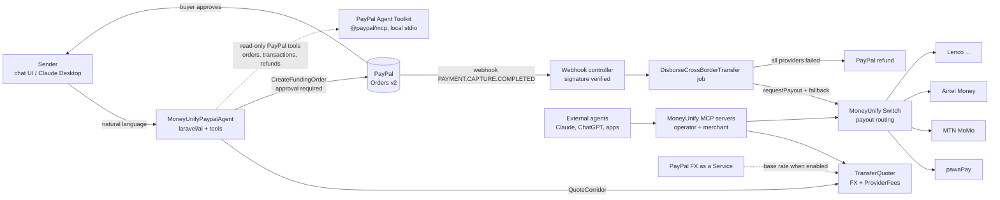

# Implementation Guide: MoneyUnify-PayPal

This guide describes what MoneyUnify-PayPal is, how it fits into the existing switch, and how each component is built and tested.

---

## 1. The product in one paragraph

**MoneyUnify-PayPal** is an AI agent that lets anyone with a PayPal account pay someone who only has mobile money. A sender in the US, UK or EU tells the agent what they want: "pay my sister's school fees in Lusaka" or "send K2,000 to my mum's Airtel number". The agent:

1. Works out the recipient and corridor.
2. Quotes the cheapest route, with fees and the FX rate shown.
3. Asks for approval, then collects in **PayPal**.
4. Uses the MoneyUnify switch to settle in local currency to **MTN, Airtel, M-Pesa or Zamtel**, falling back across providers automatically.
5. Refunds the PayPal payment if delivery fails.

Every step is guarded by spending limits and logged for audit.

---

## 2. Key decisions

| Decision | Detail |
|---|---|
| **License** | Apache-2.0 (`LICENSE.txt`, `NOTICE`). |
| **AI SDK** | [Laravel AI SDK](https://laravel.com/ai) (`laravel/ai` ^1.2). It provides agents, tools, conversation memory, human tool approval, streaming, provider failover, and fakes for testing. |
| **MCP** | `laravel/mcp` ^1.0, both as a **server** (exposing MoneyUnify tools) and as a **client** (giving our agent PayPal's MCP tools). |
| **Model** | Anthropic Claude by default (`AI_PROVIDER=anthropic`), with failover. Self-hosters can switch provider via `.env`; see `prezet/content/ai-and-mcp.md`. |
| **Sandbox first** | Development and testing run against the PayPal and pawaPay sandboxes. The simulated payout driver (§4.4) is clearly labelled wherever it appears. |

---

## 3. Architecture



Three layers, each usable on its own:

1. **Switch layer (existing, extended).** PayPal becomes a collection driver, and the switch gains **payouts** with the same fallback and cost-aware routing it already has for collections.
2. **Transfer layer (new).** A `CrossBorderTransfer` links a PayPal funding leg to a mobile-money payout leg. It covers quotes, the state machine, webhooks and refunds.
3. **Agent layer (new).** Laravel AI SDK agents whose tools sit behind server-side guardrails. The Send Money agent also gets PayPal's Agent Toolkit (read-only tools). Two MoneyUnify MCP servers, one for operators and one per merchant, let *any* agent or app use MoneyUnify, alongside PayPal's own tools.

All business logic lives in plain services (`FxQuoter`, `ProviderRouter`, `PayoutDispatcher`, `CrossBorderTransferService`). AI tools and MCP tools are thin adapters over those services, so the agent, the MCP server, the HTTP API and the tests all exercise the same code.

---

## 4. Workstreams

### 4.1 PayPal collection driver ✅

| Piece | Location | Role |
|---|---|---|
| `PaypalController` | `app/Http/Controllers/Providers/` | The driver. Implements `PaymentProviderInterface` and is auto-discovered like every other driver. |
| `PaypalClient` | `app/Support/Paypal/` | The PayPal REST client: OAuth token (cached, refreshed once on a 401), Orders v2 create/show/capture, and webhook signature verification. |
| `PaypalException` | `app/Support/Paypal/` | Carries PayPal's HTTP status and `issue` code (e.g. `ORDER_ALREADY_CAPTURED`). |
| `PaypalEnvironment` | `app/Enums/` | `sandbox` / `live`, and each one's API host. |
| `Currency` | `app/Support/` | Resolves the charge currency and which drivers can charge it. |
| `TransactionVerifier` | `app/Support/` | One verify-and-notify path shared by the verify API, checkout returns and webhooks. |

- **Config fields:** `client_id`, `client_secret`, `environment` (a `sandbox`/`live` select) and an optional `webhook_id`. Drivers can now mark a config field `'required' => false`.
- **Currency routing.** `POST /api/v1/payment/request` accepts an optional `currency`. Only providers that can charge it are tried, so a fallback never charges the same amount in another currency. Drivers declare `SUPPORTED_CURRENCIES`; without it they charge their market currency only. PayPal therefore only takes part when the request names a PayPal currency such as `USD`. HUF, JPY and TWD must be whole amounts.
- **`requestPayment`** creates the order with intent `CAPTURE`, using the transaction id as `PayPal-Request-Id` and `custom_id`. Signed return and cancel URLs are passed in `experience_context`, and the payer's email (from `email`, or an email-shaped `account_number`) pre-fills PayPal's login. The response adds `checkout_url`.
- **`verifyPayment`** reads the order and captures it if `APPROVED`, using `capture-{orderId}` as the request id. `ORDER_ALREADY_CAPTURED` is read back rather than failing. An expired order (404) or declined capture (422) is final, and a PayPal outage returns 502 with the transaction untouched. A settled transaction is only ever re-read, never captured or downgraded, so a cancelled order can't be charged later.
- **Checkout return.** `GET /checkout/paypal/{transaction}/return` and `/cancel` are signed links that ignore PayPal's appended `token` and `PayerID` (`PaypalCheckoutController`). They verify, then redirect to the merchant's optional `return_url` with `transaction_id` and `status` appended, or show `resources/views/checkout/result.blade.php`.
- **Logging.** Provider call logs now redact secrets in JSON **response** bodies as well as requests, so OAuth access tokens from any driver are never stored.

### 4.2 PayPal webhooks ✅

- **Route:** `POST /api/webhooks/paypal/{provider}` (`webhooks.paypal`), outside API-token auth and throttled to 120 per minute (`PaypalWebhookController`).
- **Verification:** `POST /v1/notifications/verify-webhook-signature` with the provider's `webhook_id`. The raw event body is spliced in untouched, because re-encoding it can break the signature. Missing transmission headers are rejected without calling PayPal.
- **Handling:** every genuine event re-verifies the order it refers to (`resource.supplementary_data.related_ids.order_id`, or the order itself for `checkout-order` events). State therefore always comes from PayPal, never from the event body.
- **Idempotency:** deliveries are stored in `provider_webhook_events` (unique per provider and event id). A processed event is acknowledged without reprocessing. If PayPal is unreachable, the response is 503 and the event stays unprocessed, so PayPal redelivers it.

### 4.3 Payouts in the switch (new capability) ✅

_Also step 1 of [TREASURY_MODULE.md](TREASURY_MODULE.md), which tracks the wider treasury plan (ledger, balances, floats, transfers)._

**Built (2026-10-15):** see TREASURY_MODULE.md step 1 "Done" for the full list. Two differences from the plan below:
- Routing reuses `ProviderRouter` with a capability filter instead of a separate `PayoutRouter`.
- The payout API lives in `PayoutController`.

A double-entry ledger (TREASURY_MODULE.md step 2) records every settled payment and payout.

Every driver today is collection-only (`direction = 'credit'`). The `transactions.direction` column already allows `debit`.

- New `app/Contracts/PayoutProviderInterface.php`:
  - `requestPayout(Transaction $transaction, array $recipient): JsonResponse`
  - `verifyPayout(Transaction $transaction): JsonResponse`
- Implement it first on **pawaPay**, which has a public sandbox with payouts across about 20 markets. Then add MTN MoMo Disbursement and Airtel Money if time allows.
  _Built:_ pawaPay and **Lenco** (Zambia and Malawi mobile money, `POST /transfers/mobile-money`).
- `PayoutRouter` reuses the collection routing:
  1. Filter by country.
  2. Apply cost-aware ordering.
  3. Fall back sequentially.
  4. Use the same "no time bound" rule to avoid double payouts.

  Extract the shared loop from `SwitchController` into a reusable router, rather than copying it.
- New public API: `POST /api/v1/payout/request` and `POST /api/v1/payout/verify`, with docs in `prezet/content/api/`.
- **Coverage.** `Coverage` reports payout-capable providers separately, so the landing page shows "collect in X / pay out in Y".

### 4.4 Simulated payout driver ✅

`SandboxPayoutController` implements `PayoutProviderInterface`. It succeeds or fails based on the MSISDN suffix (`...0000` fails, everything else succeeds after a short delay). It's labelled **"Simulated"** in the dashboard and only registers when `APP_ENV != production`. This makes the **fallback and refund** paths reproducible end to end, without depending on a third-party sandbox.

### 4.5 Cross-border transfers (PayPal → mobile money) ✅

**How MoneyUnify does it.** The operator owns both accounts: a PayPal business account and a mobile-money payout account (e.g. pawaPay or Lenco) that holds a float in the recipient's currency. No money crosses between providers during a transfer:

1. The sender pays the operator's **PayPal** account (e.g. 92.30 USD) through a normal PayPal checkout.
2. Once PayPal confirms the capture, the switch **pays the recipient's wallet from the operator's payout float** (e.g. 2,500.00 ZMW), at the FX rate locked when the transfer was quoted.
3. If the payout can't be delivered, the switch **refunds the PayPal payment** in full.
4. The operator rebalances the two accounts later (Treasury transfers, AI rebalancing suggestions).

This is the prefunding model remittance companies use. The recipient is paid in seconds, and FX is recorded on both legs.

```
awaiting_payment → funded → paying_out → delivered
                 ↘ payment_failed       ↘ payout_failed → refunding → refunded (or refund_failed, retryable)
```

**Built (2026-10-15).** The plan called this `PaypalTransfer`. It's built as `CrossBorderTransfer`, because the funding side isn't tied to PayPal: any driver that implements `RefundsPayments` can fund a transfer.

| Piece | Where |
|---|---|
| Model and timeline | `CrossBorderTransfer` (`cross_border_transfers`): funding and payout legs as FKs to `transactions`, amounts in minor units, recipient, the locked FX (`fx_quote_id`, `fx_base_rate`, `fx_rate`, `fx_margin_percent`, `fx_margin_minor`), refund leg, status, failure reason, idempotency key. Every step is written to `cross_border_transfer_events`. |
| State machine | `App\Enums\CrossBorderStatus` (`canTransitionTo`, `isFinal`, `label`). Transitions take a row lock and only move from the expected status, so each step happens once. |
| Quote | `CrossBorderTransferService::quote()`: locks FX with `FxQuoter` (recipient gets exactly the amount by default, or the sender pays exactly it), routes the funding account (`ProviderRouter` with the `RefundsPayments` capability) and the payout providers (`PayoutProviderInterface`), and estimates both providers' fees. Refused up front if nothing can deliver. |
| Funding | `request()` creates the transfer, then a PayPal order through the PayPal driver. The funding transaction carries `is_fx` and `fx_rate`. |
| Trigger | `TransactionObserver::saved()` → `transactionChanged()`. A captured funding payment (checkout return, webhook or verify) marks the transfer `funded` and queues `DisburseCrossBorderTransfer`. |
| Payout | `disburse()` uses `App\Support\Payouts\PayoutDispatcher`, extracted from `PayoutController` so the API and transfers share one fallback: next provider only after a definite refusal, stop on an unknown outcome. The payout transaction carries `is_fx` and `fx_rate`. |
| Refund | `RefundCrossBorderTransfer` → `RefundsPayments::refundPayment()`. PayPal: `POST /v2/payments/captures/{id}/refund` with a stable `PayPal-Request-Id`, so a retry never refunds twice. The refund is its own debit transaction (`refund_of_id`), recorded in the ledger as `refund`. |
| API | `POST /api/v1/transfer/quote`, `/request` (with `Idempotency-Key`), `/verify`. Documented in `prezet/content/api/cross-border-transfers.md`. |
| Tests | `tests/Feature/CrossBorderTransferTest.php`: delivery end to end, refused payout → refund, refused refund → retry, unfinished payment, single payout, idempotency, quote ownership, no route. |

**Who pays the fees.** The sender pays exactly the quoted amount and the recipient gets exactly the quoted amount. Provider fees are paid by the operator and shown as `operator_fees`. The operator's income is the FX margin.

**Since built:** the transfer is linked to the AI conversation that started it (`conversation_id`, §4.6); the sender is emailed when it's delivered or refunded (`PayerNotifier`, §4.11); the Send Money page shows a live timeline (§4.8).

**Proven end to end in the sandboxes (2026-10-18):** a PayPal sandbox payment at PayPal's FX rate (USD 1.02 for ZMW 20.00) was captured and paid out through pawaPay's sandbox to `260763456789` (delivered six seconds after capture); a second to `260763456079` was refused by pawaPay ("The payment would exceed customers maximum allowed balance.") and refunded through PayPal automatically, with balanced ledger entries for both.

**Not done yet:** notifying the recipient (only the sender is emailed).

### 4.6 The AI agent (Laravel AI SDK) ✅

**Built (2026-10-15) as `App\Ai\Agents\SendMoneyAgent`** (Promptable, `RemembersConversations`, `HasTools`, account AI credentials with failover):
- Tools in `app/Ai/Tools`: `ListCorridors`, `QuoteTransfer`, `StartTransfer` (**`Approvable`, always requires approval**, with the recipient and amount as the reason) and `GetTransferStatus`. All are thin adapters over `CrossBorderTransferService` (§4.5). PayPal's **Agent Toolkit** tools are added when PayPal MCP is on, read-only only (`get_`, `list_`, `show_`, `search_`, `retrieve_`, `track_`, e.g. `get_order`, `list_transactions`, `get_refund`, `list_disputes`), so the assistant can read PayPal's record but never move or refund money through PayPal. They come from PayPal's official MCP server (`@paypal/mcp` 1.8.1, built on `@paypal/agent-toolkit`), run locally over stdio (`PAYPAL_MCP_TRANSPORT=local`): PayPal's hosted sandbox server answered only over SSE (`/http` returned 404), which the MCP client doesn't speak. Verified live: 28 tools listed, and `get_order` returned a captured sandbox order.
- Grounding: `TransferIntent` lets the agent quote or start a transfer only for an amount and a number the user typed in this conversation (a failed turn once turned "3 kwacha" into USD 20; it can't now). One conversation per session, with an AI-written title, and **Recent conversations** (paginated) under the form.
- Guardrails in code: `TransferLimits` enforces `TRANSFER_MAX_PER_TRANSACTION_USD` and `TRANSFER_MAX_DAILY_USD` for **every** cross-border transfer (API, dashboard or agent). Tools only see the account's providers and transfers, and a conversation can only be continued by its owner (`VerifiesConversationOwnership`).
- Audit: transfers carry `origin` (`api`, `dashboard`, `agent`) and the agent's `conversation_id`.
- Endpoints: `POST /send/assistant` (message) and `POST /send/assistant/decide` (approve or reject the pending tool calls, resumed with `Decisions`).
- Tests: `tests/Feature/SendMoneyAgentTest.php`.

**Not done yet:** streaming replies, `ExplainRouting`, the "first-time recipient" approval reason and the `PaymentsAnalystAgent`. (The MoneyUnify MCP servers, §4.7, are built.) The plan below is kept for reference.


`config/ai.php`, `config/mcp.php` and the `agent_conversations` migration are already published. Keys are set in `.env`, as described in `prezet/content/ai-and-mcp.md`.

**Agent:** `php artisan make:agent MoneyUnifyPaypalAgent` → `app/Ai/Agents/MoneyUnifyPaypalAgent.php`

```php
// Provider comes from AI_PROVIDER (config/ai.php), so self-hosters can switch models.
#[MaxSteps(10)]
#[Timeout(120)]
class MoneyUnifyPaypalAgent implements Agent, Conversational, HasTools
{
    use Promptable, RemembersConversations;

    public function instructions(): Stringable|string { /* role, corridors, guardrail explanations */ }

    public function tools(): iterable
    {
        return [
            new ListCorridors,
            new ResolveRecipient,
            new QuoteCorridor,
            (new CreateFundingOrder)->requireApproval('Confirm the amount and recipient before PayPal checkout.'),
            new GetTransferStatus,
            new CancelTransfer,
            new ExplainRouting,
            ...(PaypalMcp::clientFor($this->credentialsOwner)?->tools() ?? []), // the account's PayPal MCP tools
        ];
    }
}
```

- **Per-account credentials with failover ✅.** Agents use `UsesAccountAiCredentials` (`->usingCredentialsOf($user)`), whose `provider()` returns the account's ordered failover chain from `AiProviderChain`. Each account manages its providers on the **AI & Agents** page (`ai_credentials`: provider, optional model, optional encrypted key, priority). A blank key falls back to that provider's `.env` key, providers with no key are skipped, and an account with none falls back to `AI_PROVIDER`. Account keys run on their own on-demand provider (`Ai::build`), never replacing the shared `.env` one. `PaypalMcp::clientFor($user)` connects with the account's PayPal provider (environment-matched URL, auto-refreshed token), falling back to the `.env` `paypal` client. Each provider row has a **Test** button (`ConnectionCheck`).
- **Conversation memory.** `RemembersConversations` plus `HasConversations` on `User`. Start a chat with `->forUser($user)->prompt(...)`. Resume with `->continue($conversationId, as: $user)`, after checking the conversation belongs to the user.
- **Streaming to the React UI.** `->stream($message)->usingVercelDataProtocol()` from a controller route, which the chat pane consumes.
- **Failover.** Pass `[Lab::Anthropic => 'claude-sonnet-5-5', ...]` style provider/model lists so rate limits or overloads fail over instead of erroring.
- **PayPal MCP client.** Configure a named `paypal` client in the Laravel MCP config, pointing at PayPal's remote MCP server and authenticated with the sandbox access token from the PayPal provider config. The agent can then also create PayPal invoices or look up orders natively.

**Tools:** `php artisan make:tool <Name>` → `app/Ai/Tools/`. Each tool implements `Laravel\Ai\Contracts\Tool` (`description()`, `schema(JsonSchema $schema)`, `handle(Request $request)`) and is a thin wrapper over the services above.

| Tool | What it does | Side effects |
|---|---|---|
| `ListCorridors` | Countries and networks we can pay out to | none |
| `ResolveRecipient` | Normalises an MSISDN, detects the country and network, and returns a masked name if the provider supports lookup | none |
| `QuoteCorridor` | All-in quote: fees, FX, cheapest route and fallbacks | creates a `quoted` transfer |
| `CreateFundingOrder` | Creates the PayPal order and returns the approval link | moves the transfer to `awaiting_approval`; **`Approvable`** |
| `GetTransferStatus` | Reads the transfer timeline | none |
| `CancelTransfer` | Cancels before funding | state change |
| `ExplainRouting` | Explains in plain English why provider A was chosen over B, using the logs | none |

**Guardrails.** These are enforced in code, not in the prompt.

- **Two human approvals before money moves.**
  1. `CreateFundingOrder` implements `Approvable` (with `InteractsWithApprovals`). The agent run pauses (`$response->hasPendingApprovals()`), and the UI shows the pending call's amount, recipient and reason. The sender's choice resumes it with `Decisions::from([$callId => Decision::approve()])` or `Decision::reject('...')`.
  2. The sender then approves the payment itself on PayPal's own checkout.
- **Spending limits.** A per-sender cap per transaction and per day in `config/moneyunify_paypal.php`. `needsApproval()` and `handle()` both refuse amounts above the cap with a structured error, and the agent explains the refusal.
- **Recipient confirmation.** First-time recipients always require approval, with the reason "new recipient". Repeat recipients under the cap still need approval, but carry a lighter reason.
- **Quote expiry.** Funding must happen before `quote_expires_at`, so FX risk stays bounded.
- **Audit.** Tool calls and results are persisted in the SDK's conversation tables and linked to the transfer by `conversation_id`. They are shown in the transfer timeline.
- **Prompt-injection hygiene.** Recipient names and free-text fields are treated as data. Tool outputs never include instructions.

**Where the AI adds real value:**

1. Turning messy intent into a precise transfer: "my mum in Kitwe, the Airtel number I used last time, about $50".
2. Explaining cost trade-offs in plain language: "MTN via pawaPay is 1.2% cheaper than Airtel today".
3. Proactive recovery: "the first provider timed out, I rerouted through Lenco, delivered in 40s".
4. Merchant-side **Ask your payments**: "why did payouts to Uganda fail yesterday?". This uses a second, read-only agent (`PaymentsAnalystAgent`) over `transactions` and `provider_logs`, with structured output (`HasStructuredOutput`) for tables and charts.

### 4.7 MoneyUnify MCP servers (`laravel/mcp`) ✅

**Built (2026-10-18)** in `app/Mcp`, registered in `routes/ai.php`. Every tool calls the same controller action as the REST API (`SwitchTool::forward`), so validation, routing, fallback, limits, idempotency and logging are identical.
- **Operator** (`/mcp/operator`, the account's API token, `AuthenticateMcpOperator`): 21 tools for direct payments (quote, collect, check, refund), payouts, transfers (quote, start, check, list), the merchant gateway (onboard, update, charge, settlements, pay links), FX (rates with `rate_source`, locked quotes) and treasury balances.
- **Merchant** (`/mcp/merchant`, a per-merchant `mu_mk_` key, hashed, issued, replaced or revoked from **Merchants → AI & apps**, `AuthenticateMcpMerchant`): 9 tools scoped to that merchant (profile, quote, charge, payments, check payment, pay links). Another merchant's data reads as not found.
- Each client has its own limit (`throttle:mcp`, 120 a minute per server and token). Tools carry MCP read-only and destructive hints; the servers' instructions require confirming amounts and passing `idempotency_key`.
- Verified over real HTTP: handshake, `tools/list` (21) and `quote_transfer` returning PayPal's FX rate. Tests: `tests/Feature/MoneyUnifyMcpTest.php`. Docs: `prezet/content/mcp.md`.

### 4.8 UI (Inertia + React) ✅

**Built (2026-10-15):** the **Send Money** page (`resources/js/pages/send/index.tsx`, `SendMoneyController`), in the sidebar:
- **Form tab:** a live quote as you type (rate, margin, route, estimated fees, lock countdown), then **Pay with PayPal**, which starts the transfer and redirects to PayPal checkout. The sender returns to the page afterwards.
- **Assistant tab:** a chat with `SendMoneyAgent`, with an approve/reject card for transfers and a Pay with PayPal button (`resources/js/components/send-money-assistant.tsx`).
- **Transfers:** a searchable, paginated list with a progress bar (paid → sending → delivered, or the refund path), a timeline and **Check now**. It polls while a transfer is in flight, and `cross-border:refresh` runs every minute to move transfers forward.

**How payers pay:**
- **Merchant pay pages** show **PayPal's own button from the JS SDK v6** (`PaypalSdkButton`): `createInstance` with the collecting account's public client ID, `findEligibleMethods`, a one-time payment session started from the click, the order created on our server (`POST /pay/{merchant}/order`, no return links) and captured after approval (`POST /pay/receipt/{reference}/capture`). Verified live: the sandbox SDK (6.68.0) loaded and rendered its button. If it can't load, or the order belongs to another PayPal app, the page falls back to the classic redirect.
- **Send Money page** and the API use PayPal's hosted checkout (redirect to the approval link).
- Both offer **Debit or credit card**: PayPal's guest card checkout (`landing_page: GUEST_CHECKOUT`) for payers without a PayPal account.

**Not done yet:** corridor KPIs on the dashboard. (Merchants' public pay pages, `pay/{merchant}` and `pay/l/{link}`, are built.)


The original plan (separate `paypal-transfers` pages and a public `pay/{transfer}` page) was replaced by the Send Money page and the merchants' pay pages above.

### 4.8b Refunds and merchant settlement for aggregators ✅

**Refunds (built 2026-10-17).** `App\Support\Refunds\PaymentRefunder` refunds any completed payment from a driver that implements `RefundsPayments`, in full or in part. Each refund is a debit transaction (`refund_of_id`); a payment-level lock and the refundable balance (paid less successful and pending refunds) stop over-refunding. PayPal refunds carry our id as `custom_id` and a stable `PayPal-Request-Id`. Refunds made in PayPal's dashboard are synced when the order is re-read (webhook or verify), and an unconfirmed refund is retried with the same request. Payments that fund a cross-border transfer are refused (the transfer refunds itself). API: `POST /api/v1/payment/refund` and `/refund/verify`; dashboard: **Refund** on a payment. Tests: `tests/Feature/RefundTest.php`.

**Merchants (built 2026-10-17).** The impact case: an aggregator, DFSP, FSP or operator runs MoneyUnify with its own PayPal and payout accounts and collects for many merchants.
- `merchants` (settlement wallet, country, currency, commission %, active) and `cross_border_transfers.merchant_id`, `commission_minor`, `payer_email`.
- `CrossBorderTransferService::quoteForMerchant()` and `collectForMerchant()`: the customer pays with PayPal; the merchant is settled to its wallet at the locked rate, less the commission (rounded in the merchant's favour). Only the per-transfer cap applies.
- Public pay page per merchant (`/pay/{slug}`, `MerchantPayController`) with a live quote and a live receipt (`/pay/receipt/{reference}`).
- Merchant API (`/api/v1/merchants`: list, create, update, quote, charge with `Idempotency-Key`, settlements).
- Dashboard **Merchants** page with impact figures: merchants paid, payments settled, totals settled to mobile money and commission per currency, and the average all-in cost to merchants (optionally against `IMPACT_BENCHMARK_COST_PERCENT`).
- Tests: `tests/Feature/MerchantTest.php`. Docs: `prezet/content/merchants.md`, `prezet/content/api/merchants.md`, `prezet/content/api/refunds.md`.

### 4.9 Tests (Pest)

Agents are tested with the SDK's fakes, so no real model calls happen in CI. Use `MoneyUnifyPaypalAgent::fake([...])->preventStrayPrompts()`, `AgentResponse::fakeWithPendingApprovals([...])`, `assertPrompted()` and `assertNeverPrompted()`. Tools are tested directly by calling `handle()` with a `Laravel\Ai\Tools\Request`.

| Test file | Covers |
|---|---|
| `tests/Feature/PaypalPaymentTest.php`, `PaypalCheckoutTest.php`, `PaypalWebhookTest.php` | OAuth, orders (`Http::fake`), `checkout_url`, guest card checkout, capture on return and verify, webhook signatures and duplicates |
| `tests/Feature/PaypalFxTest.php` | PayPal FX quotes, caching, inversion and cross rates, fallback when not provisioned, locked `fx_id` on orders, market-event retry, quick try when PayPal is slow, warm-up command |
| `tests/Feature/PaypalReceiptTest.php`, `RefundTest.php` | PayPal-verified receipts, signed links, refunds (full, partial, from PayPal), a failed lookup never wiping a settled payment |
| `tests/Feature/CrossBorderTransferTest.php`, `SendMoneyPageTest.php`, `SendMoneyAgentTest.php`, `Unit/TransferIntentTest.php` | The transfer state machine, delivery, refund on a failed payout, idempotency, the Send page, the agent's approvals, grounding and send-only guardrails |
| `tests/Feature/PayoutTest.php`, `PawapayPaymentTest.php`, `LencoPayoutTest.php`, `PayoutsCheckTest.php` | Payout fallback, pawaPay v2 requests and statuses (incl. NOT_FOUND rules), Lenco, the sandbox-only payout check |
| `tests/Feature/MerchantTest.php`, `PaymentLinkTest.php` | Merchants, pay links, settlement, commission, the JS SDK order and capture endpoints |
| `tests/Feature/MoneyUnifyMcpTest.php`, `AiProviderChainTest.php` | Both MCP servers over HTTP and in-process, merchant isolation, per-client rate limits, key issue and revoke; the Agent Toolkit transport |
| `tests/Feature/PayerNotificationTest.php`, `DemoSeederTest.php`, `DocsTest.php` | Payer emails, demo data, and that the docs describe what's built |

630 tests pass (plus 1 skipped) as of 2026-10-18. Run them with `php artisan test --compact --filter=...`, and run `vendor/bin/pint --dirty --format agent` before each commit.

### 4.10 Docs and housekeeping ✅

- `public/paypal.png`, a PayPal section in `prezet/content/providers.md`, and the pages `api/payouts.md`, `api/fx.md`, `api/merchants.md`, `api/refunds.md`, `api/cross-border-transfers.md`, `merchants.md`, `ai-and-mcp.md` and `mcp.md`.
- PayPal sandbox keys, `PAYPAL_SANDBOX_*` and `PAWAPAY_SANDBOX_TOKEN` (for demo data), and the MCP settings in `.env.example`.
- The README "Built with" section and build status are kept to what's built and verified.

### 4.11 Since the plan ✅

Built after the original plan, each with tests and docs:
- **PayPal FX as a Service:** quotes use PayPal's own rate for accounts whose business account has it (`PaypalFxRates`), with `rate_source` everywhere, `fx_id` locked on orders in another currency, and MoneyUnify's rates as the fallback. Live on our sandbox: USD→ZMW 20.0335 and USD→KES 133.5385 (2026-10-18). Rates are fetched ahead of time (`paypal-fx:warm`, every 30 minutes) and PayPal gets one quick try, so quotes never wait on a slow PayPal.
- **PayPal-verified receipts** with a signed permanent link, and **payer emails** when money is delivered or refunded.
- **pawaPay API v2** (`/v2/deposits`, `/v2/payouts`, `/v2/predict-provider`), verified against pawaPay's sandbox: payouts to its test numbers completed, failed (with pawaPay's reason kept) and stayed pending as documented, and a deposit completed. A payout pawaPay accepted is never treated as lost.
- **Demo data:** `composer setup --demo-data` (or `php artisan demo:seed`) creates a demo account with a week of activity through the real flows; never in production.
- **Sandbox payout check:** `php artisan payouts:check {provider}` sends one small payout through a sandbox provider and follows it (refuses live accounts).
