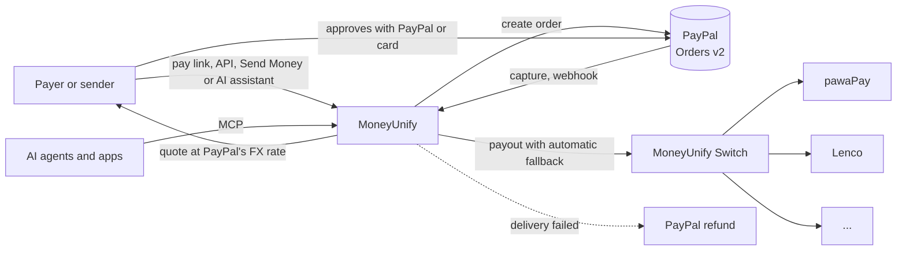

# MoneyUnify Switch


> **PayPal AI Hackathon 2026 entry: MoneyUnify-PayPal.** MoneyUnify is an
> open-source payment engine that connects PayPal to African mobile money. A
> business integrates it once and can take PayPal payments from anyone in the
> world and settle them straight to a mobile-money wallet, in local currency,
> at PayPal's own exchange rate, through an API, a pay link or an AI agent.
> [Read the summary ↓](#moneyunify-paypal-paypal-to-mobile-money-with-an-ai-agent)

## Table of Contents

- [MoneyUnify-PayPal: PayPal to mobile money, with an AI agent](#moneyunify-paypal-paypal-to-mobile-money-with-an-ai-agent)
  - [At a glance](#at-a-glance)
  - [The problem](#the-problem)
  - [What MoneyUnify does](#what-moneyunify-does)
  - [Who it's for, and the impact at scale](#who-its-for-and-the-impact-at-scale)
  - [How it works](#how-it-works)
  - [Proven end to end](#proven-end-to-end)
  - [Safety built in](#safety-built-in)
  - [Operating model and compliance](#operating-model-and-compliance)
  - [Built with](#built-with)
  - [Run it yourself](#run-it-yourself)
  - [Build status](#build-status)
- [Introduction and Objective](#introduction-and-objective)
  - [What does MoneyUnify do?](#what-does-moneyunify-do)
  - [Documentation](#documentation)
- [Supported Countries and Mobile Networks](#supported-countries-and-mobile-networks)
- [Requirements](#requirements)
  - [Installing PHP and its extensions](#installing-php-and-its-extensions)
- [Local Setup](#local-setup)
  - [With Docker](#with-docker)
  - [Without Docker](#without-docker)
- [Documentation Site (`/docs`)](#documentation-site-docs)
- [API Documentation & Consumption](#api-documentation--consumption)
- [Authors](#authors)
- [Contributing](#contributing)
- [Show Your Support](#show-your-support)
- [License](#license)

## MoneyUnify-PayPal: PayPal to mobile money, with an AI agent

### At a glance

| | |
| --- | --- |
| **The gap** | Mobile money moved more than **$2 trillion** in 2025, **$1.4 trillion** of it in Sub-Saharan Africa, across 2.3 billion accounts (GSMA, 2026). Very little of it can be reached from a PayPal wallet. |
| **The problem** | Hundreds of millions of Africans are paid and pay on mobile money. The world pays with PayPal. There's no simple, trustworthy path between the two, and every business that wants one has to integrate PayPal, an FX source and each mobile-money operator separately. |
| **The solution** | One engine that does it once. MoneyUnify collects with PayPal, converts at PayPal's own exchange rate, and pays out to MTN, Airtel, Zamtel, M-Pesa and other wallets, falling back across providers and refunding automatically if delivery fails. |
| **Who uses it** | Aggregators, payment service providers, DFSPs, mobile-money operators and e-commerce businesses, as their own payment tool, as a gateway for their merchants, or both. |
| **How people use it** | A pay link, a REST API, a Send Money page, an AI assistant that turns "send K500 to my brother" into an approved transfer, and MCP servers for any AI agent or app. |
| **Scale** | **204 countries reached:** payers in PayPal's 201 markets can pay in, and money is collected and paid out on mobile money in 32 countries, through 14 payment providers and 24 currencies, with PayPal FX into 100+ currencies. |
| **Proof** | A real PayPal sandbox payment delivered to a mobile wallet through pawaPay's sandbox in six seconds, and a failed delivery refunded through PayPal automatically, with every step and ledger entry recorded. |

### The problem

Hundreds of millions of people across Africa keep their money on a phone:
MTN MoMo, Airtel Money, M-Pesa, Zamtel Kwacha. Their relatives abroad, and the
customers and clients who want to pay them, keep theirs in a PayPal wallet.
The two worlds barely touch.

- A nurse in London wants to pay her mother's grocery bill in Kitwe. She has
  PayPal; her mother only has an Airtel number. She falls back on cash agents,
  transfer counters and opaque fees. The World Bank's Remittance Prices
  Worldwide data ranks Sub-Saharan Africa as the most expensive region in the
  world to send money to.
- A freelance designer in Nairobi is paid by an overseas client through PayPal,
  but rent, school fees and suppliers are all paid on M-Pesa.
- A small shop in Lusaka could sell to the diaspora, but its customers abroad
  can't pay into a mobile wallet, so the sale never happens.

**The gap in numbers** (GSMA, *State of the Industry Report on Mobile Money
2026*, covering 2025):

| | 2025 |
| --- | --- |
| Value moved through mobile money worldwide | **More than $2 trillion**, double 2021's in four years, after about 20 years to reach the first trillion |
| Of which in Sub-Saharan Africa | **$1.4 trillion**, about two-thirds of the world's total |
| Registered mobile-money accounts worldwide | **2.3 billion**, up 13% (268 million new) in a year |
| Accounts active every month (30-day active) | **593 million** worldwide, up 15%; **347 million** in Africa, almost 60% of the world's |
| Registered accounts in Africa | About **1.2 billion**, more than half of the world's |

The year before, the GSMA's 2025 report counted more than $1.7 trillion moved
in 2024 and 1.1 billion of the world's 2 billion accounts in Sub-Saharan
Africa. The market isn't just large, it's accelerating. Yet the wallets where
most of it lives can't be paid into from PayPal, and the sellers, freelancers
and families who use them can't accept PayPal's customers.

The money exists on both sides. What's missing is the plumbing. Building it is
the same hard job for every business that tries: a PayPal integration, an
exchange-rate source, and a separate integration, contract and float for every
mobile-money operator in every country. So most never do, and the two worlds
stay apart.

### What MoneyUnify does

MoneyUnify is the engine that removes that work. A business integrates it once
and gets every route MoneyUnify supports, across the providers it has
contracts with.

1. **Collects with PayPal, from anyone.** Payers approve with PayPal's own
   button (JS SDK v6) or PayPal checkout, or pay by debit or credit card as a
   guest, with no PayPal account needed.
2. **Converts at PayPal's rate.** With FX as a Service on the business's PayPal
   account, every quote uses PayPal's own exchange rate, locked for ten
   minutes, and PayPal locks the rate on the order too. Without it, MoneyUnify's
   own rates are used.
3. **Delivers to the wallet.** The switch pays out in local currency through
   the business's payout providers (pawaPay and Lenco today), trying the next
   provider only when one definitely refuses, so a payout is never made twice.
4. **Never strands money.** If delivery fails, the PayPal payment is refunded
   automatically, and the payer is emailed either way when they gave an email
   address. Every step is on the
   transfer's timeline and in a double-entry ledger.
5. **Works through people and agents.** Senders can just ask the AI assistant:

   > "Send K500 to my brother on 0966554433."

   It quotes the exact amount, asks for approval, and returns a PayPal link. It
   only ever uses the amount and number the person typed, and it can check
   PayPal's own record of a payment through PayPal's Agent Toolkit. Any other
   agent or app can do the same over MoneyUnify's MCP servers.

### Who it's for, and the impact at scale

Mobile money moved more than $2 trillion in 2025, $1.4 trillion of it in
Sub-Saharan Africa, through 593 million wallets used every month (GSMA, 2026).
Very little of that market can be reached from PayPal today. MoneyUnify opens
it to whoever deploys it, and each deployment serves many merchants at once.

| Who | What they tap into |
| --- | --- |
| **PayPal** | PayPal's customers worldwide can pay people and businesses who live on mobile money, and every such payment runs through PayPal checkout and, with FX as a Service, PayPal's own exchange rate. |
| **Mobile-money operators and DFSPs** | New inbound volume from abroad into their wallets, through an engine they can run themselves. |
| **Aggregators and payment providers** | A ready-made product: onboard merchants, collect with PayPal, settle to mobile money, and earn an FX margin and commission. |
| **Merchants, freelancers and families** | Being paid by the world in the money they already use, settled in seconds. |

**One switch, used three ways:**

- **As a business's own payment tool:** collect from customers, pay out,
  refund and send transfers from its own platform.
- **As a gateway for other businesses:** an aggregator, DFSP or operator
  onboards merchants, gives each a pay link and API access, and settles them to
  their wallets less a commission.
- **Both at once,** on the same account.

**What a deploying business gets:**

- **Merchant onboarding** with a settlement wallet, currency and commission,
  from the dashboard or the merchant API (`/api/v1/merchants`).
- **Pay links** where customers anywhere pay in USD, EUR or GBP, and the
  merchant is settled in ZMW, MWK or its own currency seconds after PayPal
  confirms.
- **FX without a separate FX provider:** PayPal's own rates into 100+
  currencies, including ZMW, KES, UGX, TZS, GHS, NGN, MWK, RWF, XOF, XAF and ZAR,
  for any business with FX as a Service on its PayPal business account. This
  is what lets a DFSP, an operator or a national switch offer accurate,
  auditable cross-border pricing from an account it already has.
- **Revenue built in:** an FX margin and a commission per payment, both shown
  up front.
- **AI and app access for every merchant:** an operator MCP server for the
  business, and a merchant MCP server where each merchant connects its own apps
  or assistant with its own key and sees only its own payments.
- **Treasury:** balances per provider, float-low alerts and AI suggestions for
  topping up payout accounts, so payouts don't run dry.

PayPal gains a way to serve the businesses and families of a whole continent;
operators gain new inbound volume into their wallets; merchants get paid by
the world in the money they already use.

### How it works



1. **Quote.** MoneyUnify prices the transfer: what the payer pays, what arrives,
   the locked exchange rate and whether it's PayPal's, and the route.
2. **Collect.** It creates the PayPal order; the payer approves with PayPal or
   by card, and the payment is captured (on return, by webhook or on the next
   check, whichever comes first).
3. **Pay out.** The switch pays the recipient in local currency through the
   first payout provider that can, falling back only after a definite refusal.
4. **Settle or refund.** The transfer ends *delivered* or *refunded*, never
   stuck, with each step, both legs and the locked rate on record.

### Proven end to end

Both paths were run for real in PayPal's sandbox and pawaPay's sandbox on
October 18, 2026, with nothing simulated:

| | Delivered | Refunded |
| --- | --- | --- |
| Quote | ZMW 20.00 for USD 1.02, at PayPal's FX rate | Same |
| PayPal | Payment captured (`4MD65230XU506884F`) | Payment captured (`40U28415C5158020C`) |
| pawaPay | Paid out to `260763456789`: completed | Refused: "The payment would exceed customers maximum allowed balance." |
| Outcome | **Delivered** six seconds after capture | **Refunded** through PayPal (`5MY87816BM615422U`) nine seconds after capture |
| Ledger | Collection, PayPal fee and payout recorded | Collection, PayPal fee and refund recorded |

### Safety built in

The AI assistant does the work people find hard, but it never holds the keys.
These rules are enforced in code, not in the prompt:

- **Two approvals before money moves:** the person approves the transfer in the
  chat, then approves the payment in PayPal itself.
- **Only what the person said:** the assistant can quote or start a transfer
  only for an amount and a phone number the person typed in that conversation.
- **Send-only:** the assistant can't refund, and it gets only PayPal's
  read-only tools, so it can check a payment but never move or refund money
  through PayPal.
- **Spending limits** per transfer and per day, for every transfer from any
  channel.
- **Quotes expire,** so nobody pays at a stale exchange rate.
- **Everything is audited:** each transfer's timeline is linked to the
  conversation that started it, and every request and provider call is logged.

### Operating model and compliance

**MoneyUnify is an engine, not a payment service.** It's the technology that
businesses and developers deploy to run payments: as an aggregator collecting
and settling for merchants, as an operator, DFSP or FSP extending its services,
or simply for their own e-commerce. It solves the silo problem: instead of
integrating PayPal, an FX source and every mobile-money operator one by one,
developers integrate MoneyUnify once and route across all of them.

Like a web browser, which is a platform and not responsible for what each
business does with it, MoneyUnify doesn't hold anyone's money, doesn't onboard
customers, and isn't a licensed party in the flow. **The business that deploys
it is**, using its own PayPal business account and its own provider contracts:

| The deploying business (integrator, aggregator, operator, DFSP) is responsible for | MoneyUnify, the engine, provides |
| --- | --- |
| Licences and authorisations to collect, hold, convert and pay out money in each market | Routing across the providers it has contracts with, with fallback that never pays twice |
| KYC/KYB of its customers and merchants, and sanctions screening | Configurable spending caps per transfer and per day (`TRANSFER_MAX_PER_TRANSACTION_USD`, `TRANSFER_MAX_DAILY_USD`) |
| AML/CFT monitoring and reporting | An audit trail: every API and MCP request and every provider call logged (secrets redacted), a timeline per transfer, and a double-entry ledger |
| Consumer protection, disputes and refunds policy | Full and partial refunds, and automatic PayPal refunds when delivery fails |
| Data protection for its users | Payer emails masked on receipts; merchant MCP keys stored only as a hash and shown once; tokens, keys and secrets redacted from request logs |
| Its agreements with PayPal (including FX as a Service) and each payout provider | Human approval before an AI agent starts a transfer; the payer approves every payment on PayPal |

PayPal and the mobile-money operators also apply their own checks to the
accounts on their platforms. MoneyUnify doesn't include KYC or sanctions
screening; a deploying business adds the checks its licence requires, using
its own providers.

### Built with

| | |
| --- | --- |
| **PayPal** | JS SDK v6 (PayPal's own button on merchant pay pages), Orders v2 (create, capture, guest card checkout), FX as a Service (PayPal's exchange rates, locked to orders with `fx_id`), Refunds API (full, partial and automatic), Webhooks (signature verified), and PayPal's Agent Toolkit through its MCP integration (PayPal's official `@paypal/mcp` server) |
| **AI** | [Laravel AI SDK](https://laravel.com/ai) agents with account-level provider failover (Claude, Gemini and others): the Send Money assistant, with tool calling, human approval and conversation memory, and a treasury agent that suggests float top-ups |
| **Agent interface** | Laravel MCP: PayPal's Agent Toolkit tools for the assistant (read-only: `get_order`, `list_transactions`, `get_refund`, `list_disputes` and more), and two MoneyUnify MCP servers, one for operators (21 tools: payments, payouts, refunds, transfers, merchants, FX, treasury) and one for each merchant (9 tools, scoped to its own payments and pay links) |
| **Mobile money** | The MoneyUnify switch's 14 payment providers; payouts through pawaPay (API v2) and Lenco |
| **App** | Laravel 13, Inertia + React 19, Tailwind 4, Pest (630 tests) |

### Run it yourself

Every flow can be exercised without moving real money. MoneyUnify runs against
PayPal's sandbox and pawaPay's sandbox, and it includes a **Simulated Payouts**
provider for markets whose payout providers have no sandbox. Simulated Payouts
needs no credentials, is never available when `APP_ENV=production`, and is
never counted as real coverage. (Lenco has no sandbox, so it's used only with
live accounts.)

**Fastest start:** with Docker, `docker compose up --build` starts everything
with a demo account (`demo@moneyunify.test`, password `password`) and a week of
activity ([Run with Docker](prezet/content/docker.md)). Without Docker,
`composer setup --demo-data` does the same. See [Local Setup](#local-setup).

**Host it:** the repository includes a `Dockerfile` and a `render.yaml`
Blueprint that deploy the app, its queue worker, its scheduler and Postgres to
Render in one step. See [Deploy on Render](prezet/content/deploy-render.md).

1. **Add PayPal** on **Providers**: a sandbox app's client ID and secret, with
   environment `sandbox` (from [developer.paypal.com](https://developer.paypal.com/dashboard/applications)).
2. **Add a payout provider:** pawaPay with a sandbox API token for real
   sandbox payouts, or Simulated Payouts.
3. **Send money** on **Send Money**, with the form or by asking the assistant
   (for example *"Send K50 to 0977123456"*). Pay with a PayPal sandbox buyer
   account, or choose **Debit or credit card** to pay as a guest.
4. **Or collect for a merchant:** add one on **Merchants**, create a pay link
   and pay it as a customer.

The AI features use the AI providers each account adds on **AI & Agents**, with
the server's `.env` as the fallback. PayPal's Agent Toolkit connects
automatically through the account's PayPal provider (it needs Node.js 18+). See
[AI & MCP Setup](prezet/content/ai-and-mcp.md).

**Choosing the outcome.** The recipient's number decides what a sandbox payout
does, so every path can be shown on demand.

With **pawaPay's sandbox** (Zambia):

| Recipient number | Outcome |
| --- | --- |
| `260763456789` (MTN), `260973456789` (Airtel), `260953456700` (Zamtel) | Completed |
| `260763456079` (MTN), `260973456089` (Airtel) | Failed, so the sender is refunded through PayPal |
| `260763456129` (MTN), `260973456129` (Airtel) | Stays submitted, so the switch keeps checking it |

With **Simulated Payouts**:

| Recipient number ends in | Outcome |
| --- | --- |
| anything else, e.g. `0977123456` | Delivered |
| `0000` | Refused, so the switch falls back to the next payout provider, or refunds the sender |
| `9999` | No definite answer, so the switch verifies before deciding |
| `1111` | Accepted, then fails, so the sender is refunded through PayPal |

Each run shows across the platform: the transfer's timeline on **Send Money**,
the PayPal-verified receipt, the ledger and fees, balances and float alerts on
**Treasury**, every provider call on **Logs**, and an email to the payer
(`MAIL_MAILER=log` writes it to `storage/logs` locally).

To check a payout provider with one small sandbox payout (it refuses live
accounts, so it never moves real money):

```bash
php artisan payouts:check {provider_id}
```

### Build status

The switch existed before the hackathon. Everything below was built during it,
following the [Implementation Guide](IMPLEMENTATION_GUIDE.md).

- [x] PayPal collection: Orders v2, webhooks, guest card checkout, and PayPal's JS SDK v6 button on pay pages
- [x] PayPal FX as a Service: quotes at PayPal's own rates, locked to orders, with MoneyUnify's rates as the fallback
- [x] Payouts in the switch, with fallback that never pays twice, and a double-entry ledger
- [x] Cross-border transfers: PayPal in, mobile money out at a locked rate, refunded if delivery fails
- [x] pawaPay API v2 for collections and payouts
- [x] Refunds: full and partial, from the API and the dashboard, plus refunds made in PayPal
- [x] Merchants for aggregators: onboarding, pay links, merchant API, commission, settlement to mobile money
- [x] PayPal-verified receipts and payer emails
- [x] Send Money page and AI assistant, with PayPal's Agent Toolkit (read-only tools)
- [x] MCP servers for operators and for each merchant
- [x] Treasury: balances, float alerts, and AI rebalancing suggestions approved by a person
- [x] Demo data: `composer setup --demo-data`
- [x] Proven end to end in PayPal's and pawaPay's sandboxes
- [ ] Hosted demo

**Sources:** GSMA, [*State of the Industry Report on Mobile Money 2026*](https://www.gsma.com/sotir/) (published March 2026), as reported by [ITWeb](https://www.itweb.co.za/article/mobile-money-industry-surpasses-2tn-threshold/Kjlyr7wBwy5vk6am) and [Connecting Africa](https://www.connectingafrica.com/mobile-money/-1-4t-flowed-through-mobile-money-in-sub-saharan-africa-in-2025-gsma); GSMA, *State of the Industry Report on Mobile Money 2025*, as reported by [Forbes Africa](https://www.forbesafrica.com/current-affairs/2025/04/09/sub-saharan-africa-dominates-global-mobile-money-landscape-with-1-1-billion-accounts-new-report-finds); World Bank, [Remittance Prices Worldwide](https://remittanceprices.worldbank.org/).

## Introduction and Objective

MoneyUnify Switch is an open-source (Apache-2.0), unified payment switch API platform designed to orchestrate payment provider integrations, manage customer accounts, and process transaction flows from a centralized dashboard. The platform provides a standardized interface for multiple payment gateways, allowing applications to initiate collections and automatically failover/retry across configured providers sequentially without modifying core business logic.

<p align="center">
  <a href="https://moneyunify.one">
    
  </a>
</p>

With dynamic provider routing, real-time transaction tracking, and automatic provider credential configuration from the admin panel, MoneyUnify Switch ensures high transaction success rates and eliminates single-gateway dependency.

### What does MoneyUnify do?

Think of it like a **universal adapter for mobile money and cards**. Normally, to
collect payments you have to plug into each provider separately — MTN, Airtel,
M-Pesa, Lenco, and so on — and manage them all yourself. MoneyUnify is the single
socket you plug into once: you ask it to collect money from a customer, and it
decides which provider to use behind the scenes. If one provider is down or
declines, it automatically tries the next until the payment goes through. One
connection, all providers.

That also fixes the everyday frustration of **failed payments**. Instead of your
app talking to a single provider and getting stuck when that provider is having a
bad day, it talks to one system that quietly routes each payment across several
providers, falling back instantly when one fails — so more payments succeed on
the first try. Every attempt is recorded in one dashboard, so you always know
what happened and why: fewer failed payments, less reconciliation headache.

It's **multi-currency and multi-country** by design. Providers advertise the
markets they serve, and the switch routes each request to a provider that can
settle it in the right country and currency. Cross-currency flows are treated as
first-class: every transaction records whether it crossed currencies and the FX
rate applied, so ongoing foreign-exchange movements are tracked and reconciled
correctly rather than silently lost — a foundation for collecting in one currency
and settling in another as your markets grow.

**Provision payment gateways and power multi-region apps from one endpoint.**
Because everything sits behind a single API — `POST /api/v1/payment/request` —
MoneyUnify can act as your payment-gateway layer: point any application or website
at that one endpoint, and add, remove, or re-order the underlying providers from
the dashboard without touching a line of your code. That makes it a practical way
to roll out payments across several countries at once — a fintech offering "pay
with mobile money" in five markets, a SaaS billing customers across regions, or an
e-commerce checkout that needs MTN in one country and M-Pesa in another — all
through the same integration.

### Documentation

MoneyUnify Switch ships with a built-in documentation site served at the **`/docs`** route (installation, provider configuration, and the full API reference). It is generated from the Markdown files in [`prezet/content`](prezet/content). See [Documentation Site (`/docs`)](#documentation-site-docs) below for how to bring it up.

A standalone [API Documentation](API_DOCUMENTATION.md) file is also available for quick reference.

## Supported Countries and Mobile Networks

The built-in provider drivers collectively cover **32 countries** across Africa for mobile money: collections, and payouts through pawaPay and Lenco. With PayPal, payers in **PayPal's 201 markets** (per PayPal's [country list](https://developer.paypal.com/api/rest/reference/country-codes/)) can pay in, so the switch reaches **204 countries** in all: 29 have both, 172 are PayPal only, and Ghana, Liberia and South Sudan are mobile money only. The switch reaches a country only when you configure (and activate) a provider that supports it — coverage is the **union of the providers you configure**. See the full [Coverage reference](prezet/content/api/coverage.md) in the docs.

### Countries and currencies

Networks (MNOs) are the principal mobile-money operators reachable in each market through the listed providers — aggregators (pawaPay, Ting) auto-select the payer's operator, while operator-specific drivers route to a single network.

| Country | Code | Currency | Networks (MNOs) | Providers |
| --- | --- | --- | --- | --- |
| Benin | BJ | XOF | MTN MoMo, Moov Money | MTN MoMo, pawaPay, Ting |
| Botswana | BW | BWP | Orange Money, Mascom MyZaka, BTC Smega | Kazang |
| Burkina Faso | BF | XOF | Orange Money, Moov Money | Flutterwave, pawaPay |
| Cameroon | CM | XAF | MTN MoMo, Orange Money | Flutterwave, MTN MoMo, pawaPay, Ting |
| Chad | TD | XAF | Airtel Money, Moov Money | Airtel Money, Ting |
| Congo-Brazzaville | CG | XAF | MTN MoMo, Airtel Money | Airtel Money, MTN MoMo, pawaPay, Ting |
| Côte d'Ivoire | CI | XOF | MTN MoMo, Orange Money, Moov Money, Wave | Flutterwave, MTN MoMo, pawaPay, Ting |
| DR Congo | CD | CDF | Vodacom M-Pesa, Airtel Money, Orange Money | Airtel Money, M-Pesa (Vodacom), pawaPay, Ting |
| Eswatini | SZ | SZL | MTN MoMo | MTN MoMo, Ting |
| Ethiopia | ET | ETB | Safaricom M-Pesa, Telebirr | pawaPay |
| Gabon | GA | XAF | Airtel Money, Moov Money | Airtel Money, pawaPay, Ting |
| Ghana | GH | GHS | MTN MoMo, AirtelTigo Money, Telecel Cash | DPO Pay, Flutterwave, M-Pesa (Vodacom), MTN MoMo, pawaPay, Ting |
| Guinea | GN | GNF | MTN MoMo, Orange Money | MTN MoMo, Ting |
| Guinea-Bissau | GW | XOF | MTN MoMo, Orange Money | MTN MoMo, Ting |
| Kenya | KE | KES | Safaricom M-Pesa, Airtel Money, T-Kash | Airtel Money, DPO Pay, Flutterwave, M-Pesa (Kenya), pawaPay, Ting |
| Lesotho | LS | LSL | Vodacom M-Pesa, EcoCash | M-Pesa (Vodacom), pawaPay, Ting |
| Liberia | LR | LRD | MTN MoMo, Orange Money | MTN MoMo, Ting |
| Madagascar | MG | MGA | Airtel Money, Orange Money, MVola | Airtel Money |
| Malawi | MW | MWK | Airtel Money, TNM Mpamba | Airtel Money, DPO Pay, Lenco, MobiPay, pawaPay, Ting |
| Mozambique | MZ | MZN | Vodacom M-Pesa, e-Mola, mKesh | DPO Pay, M-Pesa (Vodacom), pawaPay, Ting |
| Namibia | NA | NAD | MTC Money | Kazang |
| Niger | NE | XOF | Airtel Money, Moov Money, Orange Money | Airtel Money, Ting |
| Nigeria | NG | NGN | MTN MoMo, Airtel Money | Airtel Money, DPO Pay, MTN MoMo, pawaPay, Ting |
| Rwanda | RW | RWF | MTN MoMo, Airtel Money | Airtel Money, DPO Pay, Flutterwave, MTN MoMo, pawaPay, Ting |
| Senegal | SN | XOF | Orange Money, Free Money, Wave | Flutterwave, pawaPay |
| Seychelles | SC | SCR | Airtel Money | Airtel Money, Ting |
| Sierra Leone | SL | SLE | Orange Money, Africell Money | pawaPay |
| South Africa | ZA | ZAR | MTN MoMo, Vodacom | Kazang, MTN MoMo, Ting |
| South Sudan | SS | SSP | MTN MoMo | MTN MoMo, Ting |
| Tanzania | TZ | TZS | Vodacom M-Pesa, Airtel Money, Tigo Pesa, Halopesa | Airtel Money, DPO Pay, Flutterwave, M-Pesa (Vodacom), pawaPay, Ting |
| Uganda | UG | UGX | MTN MoMo, Airtel Money | Airtel Money, DPO Pay, Flutterwave, MTN MoMo, pawaPay, Ting |
| Zambia | ZM | ZMW | MTN MoMo, Airtel Money, Zamtel Kwacha | Airtel Money, cGrate, DPO Pay, Flutterwave, Kazang, Lenco, Lipila, MTN MoMo, pawaPay, Ting |

### Providers and mobile networks

Aggregators (pawaPay, Ting) reach the major mobile-money operators (MMOs) in each market and pick the right one automatically; operator-specific drivers route to a single network.

| Provider driver | Markets | Mobile networks reached |
| --- | --- | --- |
| **MTN MoMo** | 15 | MTN Mobile Money |
| **Airtel Money** | 14 | Airtel Money |
| **M-Pesa (Kenya)** | 1 | Safaricom M-Pesa (STK Push) |
| **M-Pesa (Vodafone/Vodacom)** | 5 | Vodacom / Vodafone M-Pesa |
| **Lenco** | 2 | ZM: MTN, Airtel, Zamtel · MW: Airtel, TNM |
| **Lipila** | 1 | Zambia: MTN, Airtel, Zamtel |
| **cGrate** (Konse Konse 543) | 1 | Zambia: MTN, Airtel, Zamtel |
| **MobiPay** (Malipo) | 1 | Malawi: Airtel Money, TNM Mpamba |
| **Kazang** (ContentReady) | 4 | ZM: MTN, Airtel, Zamtel · ZA/NA/BW: operator configured per market |
| **Flutterwave** | 10 | M-Pesa (KE); MTN, Vodafone, AirtelTigo (GH); MTN, Airtel (UG, RW); MTN, Airtel, Zamtel (ZM); Vodacom, Airtel, Tigo (TZ); MTN, Orange (CM, CI, SN, BF) |
| **DPO Pay** | 9 | Operator configured per market (MNO code) — e.g. Safaricom, Vodacom, Tigo, MTN, Airtel |
| **pawaPay** | 20 | All major MMOs per market — auto-detected (e.g. MTN, Airtel, Vodafone, Orange, Tigo, Moov) |
| **Ting by Cellulant** | 25 | All major MMOs per market — operator code configured per market |
| **PayPal** | 32 (settled to) · 201 (payers from) | None: PayPal's button or hosted checkout (wallet, guest card), charged in a PayPal currency such as USD; payers anywhere in PayPal's 201 markets |

## Requirements

- **PHP 8.4+** (8.5 recommended) with the `dom` and `gd` extensions enabled — [download](https://www.php.net/downloads.php)
- **Composer** 2.x — [download](https://getcomposer.org/download/)
- **Node.js 20+** with npm (pnpm or yarn also work) — [download](https://nodejs.org/en/download)
- A database — **SQLite is the zero-config default**; [MySQL](https://dev.mysql.com/downloads/) or [PostgreSQL](https://www.postgresql.org/download/) also work (any engine with native JSON support), configured via `.env`
- **Git** — [download](https://git-scm.com/downloads)

### Installing PHP and its extensions

You can download PHP from [php.net/downloads](https://www.php.net/downloads.php),
but on macOS and Linux it's easiest to install PHP (and the `dom` + `gd`
extensions this app needs) through your package manager.

**macOS** — using [Homebrew](https://brew.sh). The Homebrew PHP formula already
bundles `dom` and `gd`, so one install is enough:

```bash
brew install php       # PHP 8.4+ with dom, gd, mbstring, curl, sqlite3, …
brew install composer  # Composer 2.x
brew install node      # Node.js 20+
```

**Linux** — Debian / Ubuntu (`apt`). Extensions ship as separate packages, so
install them alongside the PHP CLI:

```bash
sudo apt update
sudo apt install -y php8.4-cli php8.4-dom php8.4-gd \
    php8.4-mbstring php8.4-curl php8.4-xml php8.4-sqlite3
```

> On Fedora / RHEL the equivalent is
> `sudo dnf install php-cli php-xml php-gd php-mbstring php-pdo`
> (the `dom` extension is provided by `php-xml`).

After installing, confirm the version and that the required extensions are loaded:

```bash
php -v                      # should report 8.4 or newer
php -m | grep -E 'dom|gd'   # both "dom" and "gd" should be listed
```

If an extension is missing, install its package (e.g. `php8.4-gd`) and re-run the
check — no PHP reconfiguration is needed.

## Local Setup

There are two ways to run MoneyUnify on your machine:

| | With Docker | Without Docker |
| --- | --- | --- |
| **You install** | Docker only | PHP 8.4+, Composer, Node.js 22+ |
| **Database** | Postgres, in a container | SQLite file (or your own MySQL/Postgres) |
| **Best for** | Trying it in minutes | Day-to-day development, with instant reloads |
| **Start with** | `docker compose up --build` | `composer setup`, then `composer dev` |

### With Docker

```bash
git clone https://github.com/blessedjasonmwanza/mu-switch-paypal.git
cd mu-switch-paypal
docker compose up --build
```

Open [http://localhost:8000](http://localhost:8000) and sign in with
`demo@moneyunify.test` / `password`. This starts the app, its queue worker,
its scheduler and a Postgres database, with a demo account and a week of
activity. To make real sandbox payments, copy `.env.docker.example` to
`.env.docker` and add your PayPal sandbox keys before the first start.

**Full guide:** [Run with Docker](prezet/content/docker.md) (step by step,
everyday commands and troubleshooting).

**Deploying for real?** The local setup above is a sandbox demo. To run
MoneyUnify in production on your own server, with your domain, automatic HTTPS,
no demo data and your live providers, use `compose.prod.yaml`:
[Self-Host with Docker](prezet/content/docker-production.md). To host on a
platform instead, see [Deploy on Render](prezet/content/deploy-render.md).

### Without Docker

1. Clone the repository:

```bash
git clone https://github.com/blessedjasonmwanza/mu-switch-paypal.git
cd mu-switch-paypal
```

2. Run the automated setup command:

```bash
composer setup
```

   This single command bootstraps everything:
   - installs Composer and npm dependencies,
   - creates your `.env` file (from `.env.example`) and the SQLite database file,
   - generates the application key,
   - runs the database migrations,
   - **builds the documentation index** so the `/docs` site is live,
   - compiles the front-end assets (`npm run build`).

   > **Using MySQL/PostgreSQL instead of SQLite?** Edit the `DB_*` values in `.env`
   > before running `composer setup` (or run `php artisan migrate` again afterward).

   **Want a ready-made demo?** Add `--demo-data`:

```bash
composer setup --demo-data
```

   This also adds a demo account (`demo@moneyunify.test`, password `password`) with
   a week of activity: PayPal-funded transfers delivered to mobile money, two
   refunded transfers, a merchant with a pay link and settled payments, an
   assistant conversation, the ledger and treasury balances. It's made by the
   app's own flows with PayPal's replies simulated, so nothing reaches PayPal and
   no money moves. Payouts use [Simulated Payouts](#try-it-end-to-end-judges-and-testers).
   To make new payments, add your PayPal sandbox app on the **Providers** page,
   or set `PAYPAL_SANDBOX_CLIENT_ID` and `PAYPAL_SANDBOX_CLIENT_SECRET` in `.env`
   first and it's added for you. On an existing install, run `php artisan demo:seed`.
   Demo data is never added when `APP_ENV=production`.

3. Start the development environment (runs the PHP server, Vite, queue worker, and log viewer concurrently):

```bash
composer dev
```

4. Open the app and create your first account:
   - Application: <http://localhost:8000>
   - Documentation: <http://localhost:8000/docs>

   After registering, your **API token** is shown on the dashboard, and you can add a
   payment provider from the **Providers** page.

## Documentation Site (`/docs`)

The in-app documentation lives at the **`/docs`** route and is powered by Markdown
files in [`prezet/content`](prezet/content), indexed into a small SQLite catalogue
for search and navigation.

`composer setup` already builds this index, so after setup the docs are live at
<http://localhost:8000/docs>. You only need to rebuild the index when you **add or
edit** documentation:

```bash
php artisan docs:index --fresh
```

Tips:

- While running `composer dev` (or `npm run dev`), the docs index **rebuilds
  automatically** whenever you change a file under `prezet/`.
- In **production**, run `php artisan docs:index --fresh` as part of your deploy
  (after pulling new content) so `/docs` reflects the latest documentation.
- To edit the docs, update the Markdown in `prezet/content/` and the sidebar
  navigation in `prezet/SUMMARY.md`.

## API Documentation & Consumption

To consume the payment switch APIs from external client applications, read the
**API Reference** at [`/docs`](http://localhost:8000/docs) (or the standalone
[API Documentation](API_DOCUMENTATION.md)) for endpoint specifications, payload
parameters, responses, and integration examples. In short: your application sends
a single authenticated request to `POST /api/v1/payment/request`, and the switch
routes it across your active providers with automatic fallback.

**OpenAPI spec.** The whole API (payments, refunds, payouts, transfers,
merchants, pay links and FX) is described in an OpenAPI 3.1 spec at
[`public/openapi.yaml`](public/openapi.yaml), served by every deployment at
`/openapi.yaml`. Import it into Postman, Insomnia or Swagger UI, or generate a
typed client from it. A test checks it against the API's routes, enums and real
responses, so it doesn't drift from the code.

## Authors

- 👤 **Blessed Jason Mwanza**
  - GitHub: [@blessedjasonmwanza](https://github.com/blessedjasonmwanza)
  - Email: [blessed.jason.mwanza@example.com](mailto:blessed.jason.mwanza@example.com)
  - Website: [https://blessedjasonmwanza.github.io](https://blessedjasonmwanza.github.io)
  - X (Twitter): [@mwanzabj](https://twitter.com/mwanzabj)
  - LinkedIn: [Blessedjasonmwanza](https://linkedin.com/in/blessedjasonmwanza)


## Contributing

We welcome contributions! If you want to help improve MoneyUnify Switch:

- open an issue for bugs or feature requests
- send a pull request with a clear description and tests
- follow existing code style and architecture patterns

When contributing, please:

- include a meaningful commit message
- write or update tests for your changes
- keep new features small and incremental

## Show Your Support

If this project helps you, please consider supporting the development by:

- starring the repository on GitHub
- sharing it with the community
- suggesting improvements or use cases

If you want to donate, please use the MoneyUnify team or sponsorship links associated with this repository.
- Donate via Buy Me a Coffee: [https://buymeacoffee.com/mwanzabj](https://www.buymeacoffee.com/mwanzabj)
<!-- - Sponsor on GitHub: [https://github.com/sponsors/MoneyUnify](https://github.com/sponsors/MoneyUnify) -->

## License

This project is licensed under the [Apache License 2.0](LICENSE.txt). See [NOTICE](NOTICE) for attribution.
