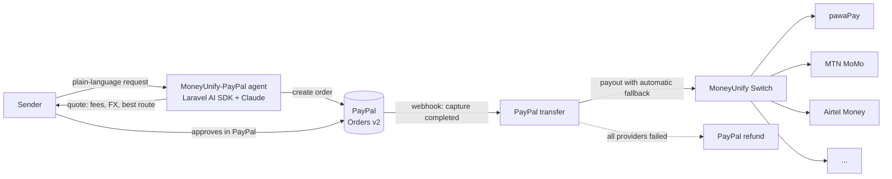

# MoneyUnify Switch


> **PayPal AI Hackathon 2026 entry: MoneyUnify-PayPal.** An AI agent that lets
> anyone with a PayPal account pay someone who only has mobile money, routed
> through the MoneyUnify switch. [Jump to MoneyUnify-PayPal ↓](#moneyunify-paypal-paypal-to-mobile-money-with-an-ai-agent)

## Table of Contents

- [MoneyUnify-PayPal: PayPal to mobile money, with an AI agent](#moneyunify-paypal-paypal-to-mobile-money-with-an-ai-agent)
  - [The problem](#the-problem)
  - [The solution](#the-solution)
  - [How it works](#how-it-works)
  - [Why an agent, and why it's safe](#why-an-agent-and-why-its-safe)
  - [Built with](#built-with)
  - [Build status](#build-status)
- [Introduction and Objective](#introduction-and-objective)
  - [What does MoneyUnify do?](#what-does-moneyunify-do)
  - [Documentation](#documentation)
- [Supported Countries and Mobile Networks](#supported-countries-and-mobile-networks)
- [Requirements](#requirements)
  - [Installing PHP and its extensions](#installing-php-and-its-extensions)
- [Local Setup](#local-setup)
- [Documentation Site (`/docs`)](#documentation-site-docs)
- [API Documentation & Consumption](#api-documentation--consumption)
- [Authors](#authors)
- [Contributing](#contributing)
- [Show Your Support](#show-your-support)
- [License](#license)

## MoneyUnify-PayPal: PayPal to mobile money, with an AI agent

### The problem

Hundreds of millions of people across Africa keep their money on a phone:
MTN MoMo, Airtel Money, M-Pesa, Zamtel Kwacha. Their relatives abroad, and the
customers and clients who want to pay them, keep theirs in a PayPal wallet.
The two worlds barely touch.

- A nurse in London who wants to pay her mother's grocery bill in Kitwe has
  PayPal, but her mother only has an Airtel number. She falls back on cash
  agents, transfer counters and opaque fees. The World Bank's Remittance Prices
  Worldwide data ranks Sub-Saharan Africa as the most expensive region in the
  world to send money to.
- A freelance designer in Nairobi is paid by an overseas client through PayPal,
  but rent, school fees and suppliers are all paid on M-Pesa.
- A small shop in Lusaka could sell to the diaspora, but its customers abroad
  can't pay into a mobile wallet, so the sale never happens.

The money exists on both sides. What's missing is a trustworthy path between a
PayPal balance and a mobile-money wallet, simple enough that you can just ask
for it.

### The solution

**MoneyUnify-PayPal** connects the two. You tell an AI agent what you want in
plain language:

> "Send mum K2,000 for groceries, same Airtel number as last time."

The agent:

1. **Understands the request.** It resolves the recipient, the country and the
   mobile network, and checks them against your past transfers.
2. **Quotes honestly.** It shows the all-in cost (fees and FX rate) and what the
   recipient will actually receive. It explains in plain English why it picked
   the cheapest provider.
3. **Collects with PayPal.** You approve in PayPal, so the money only moves when
   you say so.
4. **Delivers to the phone.** The MoneyUnify switch pays out in local currency.
   If one provider is down, it automatically tries the next one: pawaPay, MTN,
   Airtel, Lenco and so on.
5. **Never strands your money.** If every provider fails, the PayPal payment is
   refunded automatically, and you can see each step on a live timeline.

Every PayPal wallet becomes a way to pay someone on mobile money in **32
countries**. Every transfer is a new local payout through the mobile-money
networks the switch already integrates. Merchants and freelancers get paid by
PayPal customers straight into the wallet they actually use.

The same capabilities are exposed as an **MCP server**. Any AI agent, including
one already using PayPal's MCP server, can quote corridors and pay out to
mobile money. For example: *"invoice my client in PayPal, and when it's paid,
send 60% to my supplier's M-Pesa."*

### How it works



1. **Collect.** A new PayPal driver plugs into the switch like any other
   provider. It creates PayPal orders, sends the payer to approve, and captures
   the payment.
2. **Confirm.** Signature-verified PayPal webhooks mark the funding leg as paid.
3. **Pay out.** The switch, which already handles collections across 13
   providers, now also handles **payouts**, with the same country filtering,
   cost-aware ordering and automatic fallback.
4. **Settle or refund.** The transfer records both legs, the locked FX rate
   and every state change. It ends either *delivered* or *refunded*, never
   stuck.

### Why an agent, and why it's safe

The agent does the work people find hard: working out who and where, comparing
routes, explaining costs, and recovering from failures. It never holds the
keys. These rules are enforced in code, not in the prompt:

- **You approve every payment twice:** first in the chat, when the agent asks
  to create the payment, and then in PayPal itself. The agent can't move money
  on its own.
- **Spending limits** per transfer and per day. Requests over the limit are
  refused, and the agent explains why.
- **New recipients must be confirmed** before the first transfer.
- **Quotes expire**, so you never pay at a stale FX rate.
- **Every tool call is audited** and shown on the order timeline.

### Built with

| | |
| --- | --- |
| **PayPal** | Orders v2 (create, capture), Webhooks (signature verification), Refunds, JavaScript SDK v6, sandbox; works alongside the PayPal MCP server |
| **AI** | [Laravel AI SDK](https://laravel.com/ai) agents running Claude (Anthropic): tool calling for recipient resolution, quoting, routing explanations and "ask your payments" questions, with human approval before any payment, conversation memory and streaming |
| **Agent interface** | Laravel MCP: a MoneyUnify MCP server for any MCP client, and an MCP client that gives our agent PayPal's MCP tools |
| **Mobile money** | The MoneyUnify switch's 13 mobile-money and card drivers; pawaPay sandbox for payouts |
| **App** | Laravel 13, Inertia + React 19, Tailwind 4, Pest |
| **Hosting** | Render |

> **Sandbox only.** All payments run against the PayPal and provider sandboxes.
> No real money moves.

To run the AI features, each account adds one or more AI providers on the **AI &
Agents** page, in failover order, with the server's `.env` as the fallback. PayPal MCP connects
automatically through the account's PayPal provider. See
[AI & MCP Setup](prezet/content/ai-and-mcp.md).

### Build status

The switch below existed before the hackathon. MoneyUnify-PayPal is being built
during it, following the [Implementation Guide](IMPLEMENTATION_GUIDE.md).

- [x] PayPal collection driver and webhooks
- [x] Payouts in the switch, with fallback, plus a double-entry ledger
- [x] Treasury: balances, float-low alerts, and tracked transfers between accounts
- [x] Treasury agent: AI rebalancing suggestions, checked by guardrails and approved by a person
- [x] FX quotes: exchange rates and conversions locked for 10 minutes, per account
- [x] Cross-border transfers: pay with PayPal, delivered to mobile money at a locked rate, refunded if delivery fails
- [ ] AI agent with guardrails, and the transfer UI
- [ ] MCP server
- [ ] Hosted demo on Render

## Introduction and Objective

MoneyUnify Switch is an open-source (Apache-2.0), unified payment switch API platform designed to orchestrate payment provider integrations, manage customer accounts, and process transaction flows from a centralized dashboard. The platform provides a standardized interface for multiple payment gateways, allowing applications to initiate collections and automatically failover/retry across configured providers sequentially without modifying core business logic.

<p align="center">
  <a href="https://moneyunify.one">
    
  </a>
</p>

With dynamic provider routing, real-time transaction tracking, and automatic provider credential configuration from the admin panel, MoneyUnify Switch ensures high transaction success rates and eliminates single-gateway dependency.

### What does MoneyUnify do?

Think of it like a **universal adapter for mobile money and cards**. Normally, to
collect payments you have to plug into each provider separately — MTN, Airtel,
M-Pesa, Lenco, and so on — and manage them all yourself. MoneyUnify is the single
socket you plug into once: you ask it to collect money from a customer, and it
decides which provider to use behind the scenes. If one provider is down or
declines, it automatically tries the next until the payment goes through. One
connection, all providers.

That also fixes the everyday frustration of **failed payments**. Instead of your
app talking to a single provider and getting stuck when that provider is having a
bad day, it talks to one system that quietly routes each payment across several
providers, falling back instantly when one fails — so more payments succeed on
the first try. Every attempt is recorded in one dashboard, so you always know
what happened and why: fewer failed payments, less reconciliation headache.

It's **multi-currency and multi-country** by design. Providers advertise the
markets they serve, and the switch routes each request to a provider that can
settle it in the right country and currency. Cross-currency flows are treated as
first-class: every transaction records whether it crossed currencies and the FX
rate applied, so ongoing foreign-exchange movements are tracked and reconciled
correctly rather than silently lost — a foundation for collecting in one currency
and settling in another as your markets grow.

**Provision payment gateways and power multi-region apps from one endpoint.**
Because everything sits behind a single API — `POST /api/v1/payment/request` —
MoneyUnify can act as your payment-gateway layer: point any application or website
at that one endpoint, and add, remove, or re-order the underlying providers from
the dashboard without touching a line of your code. That makes it a practical way
to roll out payments across several countries at once — a fintech offering "pay
with mobile money" in five markets, a SaaS billing customers across regions, or an
e-commerce checkout that needs MTN in one country and M-Pesa in another — all
through the same integration.

### Documentation

MoneyUnify Switch ships with a built-in documentation site served at the **`/docs`** route (installation, provider configuration, and the full API reference). It is generated from the Markdown files in [`prezet/content`](prezet/content). See [Documentation Site (`/docs`)](#documentation-site-docs) below for how to bring it up.

A standalone [API Documentation](API_DOCUMENTATION.md) file is also available for quick reference.

## Supported Countries and Mobile Networks

The built-in provider drivers collectively cover **32 countries** across Africa. The switch reaches a country only when you configure (and activate) a provider that supports it — coverage is the **union of the providers you configure**. See the full [Coverage reference](prezet/content/api/coverage.md) in the docs.

### Countries and currencies

Networks (MNOs) are the principal mobile-money operators reachable in each market through the listed providers — aggregators (pawaPay, Ting) auto-select the payer's operator, while operator-specific drivers route to a single network.

| Country | Code | Currency | Networks (MNOs) | Providers |
| --- | --- | --- | --- | --- |
| Benin | BJ | XOF | MTN MoMo, Moov Money | MTN MoMo, pawaPay, Ting |
| Botswana | BW | BWP | Orange Money, Mascom MyZaka, BTC Smega | Kazang |
| Burkina Faso | BF | XOF | Orange Money, Moov Money | Flutterwave, pawaPay |
| Cameroon | CM | XAF | MTN MoMo, Orange Money | Flutterwave, MTN MoMo, pawaPay, Ting |
| Chad | TD | XAF | Airtel Money, Moov Money | Airtel Money, Ting |
| Congo-Brazzaville | CG | XAF | MTN MoMo, Airtel Money | Airtel Money, MTN MoMo, pawaPay, Ting |
| Côte d'Ivoire | CI | XOF | MTN MoMo, Orange Money, Moov Money, Wave | Flutterwave, MTN MoMo, pawaPay, Ting |
| DR Congo | CD | CDF | Vodacom M-Pesa, Airtel Money, Orange Money | Airtel Money, M-Pesa (Vodacom), pawaPay, Ting |
| Eswatini | SZ | SZL | MTN MoMo | MTN MoMo, Ting |
| Ethiopia | ET | ETB | Safaricom M-Pesa, Telebirr | pawaPay |
| Gabon | GA | XAF | Airtel Money, Moov Money | Airtel Money, pawaPay, Ting |
| Ghana | GH | GHS | MTN MoMo, AirtelTigo Money, Telecel Cash | DPO Pay, Flutterwave, M-Pesa (Vodacom), MTN MoMo, pawaPay, Ting |
| Guinea | GN | GNF | MTN MoMo, Orange Money | MTN MoMo, Ting |
| Guinea-Bissau | GW | XOF | MTN MoMo, Orange Money | MTN MoMo, Ting |
| Kenya | KE | KES | Safaricom M-Pesa, Airtel Money, T-Kash | Airtel Money, DPO Pay, Flutterwave, M-Pesa (Kenya), pawaPay, Ting |
| Lesotho | LS | LSL | Vodacom M-Pesa, EcoCash | M-Pesa (Vodacom), pawaPay, Ting |
| Liberia | LR | LRD | MTN MoMo, Orange Money | MTN MoMo, Ting |
| Madagascar | MG | MGA | Airtel Money, Orange Money, MVola | Airtel Money |
| Malawi | MW | MWK | Airtel Money, TNM Mpamba | Airtel Money, DPO Pay, Lenco, MobiPay, pawaPay, Ting |
| Mozambique | MZ | MZN | Vodacom M-Pesa, e-Mola, mKesh | DPO Pay, M-Pesa (Vodacom), pawaPay, Ting |
| Namibia | NA | NAD | MTC Money | Kazang |
| Niger | NE | XOF | Airtel Money, Moov Money, Orange Money | Airtel Money, Ting |
| Nigeria | NG | NGN | MTN MoMo, Airtel Money | Airtel Money, DPO Pay, MTN MoMo, pawaPay, Ting |
| Rwanda | RW | RWF | MTN MoMo, Airtel Money | Airtel Money, DPO Pay, Flutterwave, MTN MoMo, pawaPay, Ting |
| Senegal | SN | XOF | Orange Money, Free Money, Wave | Flutterwave, pawaPay |
| Seychelles | SC | SCR | Airtel Money | Airtel Money, Ting |
| Sierra Leone | SL | SLE | Orange Money, Africell Money | pawaPay |
| South Africa | ZA | ZAR | MTN MoMo, Vodacom | Kazang, MTN MoMo, Ting |
| South Sudan | SS | SSP | MTN MoMo | MTN MoMo, Ting |
| Tanzania | TZ | TZS | Vodacom M-Pesa, Airtel Money, Tigo Pesa, Halopesa | Airtel Money, DPO Pay, Flutterwave, M-Pesa (Vodacom), pawaPay, Ting |
| Uganda | UG | UGX | MTN MoMo, Airtel Money | Airtel Money, DPO Pay, Flutterwave, MTN MoMo, pawaPay, Ting |
| Zambia | ZM | ZMW | MTN MoMo, Airtel Money, Zamtel Kwacha | Airtel Money, cGrate, DPO Pay, Flutterwave, Kazang, Lenco, Lipila, MTN MoMo, pawaPay, Ting |

### Providers and mobile networks

Aggregators (pawaPay, Ting) reach the major mobile-money operators (MMOs) in each market and pick the right one automatically; operator-specific drivers route to a single network.

| Provider driver | Markets | Mobile networks reached |
| --- | --- | --- |
| **MTN MoMo** | 15 | MTN Mobile Money |
| **Airtel Money** | 14 | Airtel Money |
| **M-Pesa (Kenya)** | 1 | Safaricom M-Pesa (STK Push) |
| **M-Pesa (Vodafone/Vodacom)** | 5 | Vodacom / Vodafone M-Pesa |
| **Lenco** | 2 | ZM: MTN, Airtel, Zamtel · MW: Airtel, TNM |
| **Lipila** | 1 | Zambia: MTN, Airtel, Zamtel |
| **cGrate** (Konse Konse 543) | 1 | Zambia: MTN, Airtel, Zamtel |
| **MobiPay** (Malipo) | 1 | Malawi: Airtel Money, TNM Mpamba |
| **Kazang** (ContentReady) | 4 | ZM: MTN, Airtel, Zamtel · ZA/NA/BW: operator configured per market |
| **Flutterwave** | 10 | M-Pesa (KE); MTN, Vodafone, AirtelTigo (GH); MTN, Airtel (UG, RW); MTN, Airtel, Zamtel (ZM); Vodacom, Airtel, Tigo (TZ); MTN, Orange (CM, CI, SN, BF) |
| **DPO Pay** | 9 | Operator configured per market (MNO code) — e.g. Safaricom, Vodacom, Tigo, MTN, Airtel |
| **pawaPay** | 20 | All major MMOs per market — auto-detected (e.g. MTN, Airtel, Vodafone, Orange, Tigo, Moov) |
| **Ting by Cellulant** | 25 | All major MMOs per market — operator code configured per market |
| **PayPal** | 32 | None: hosted PayPal checkout (wallet and cards), charged in a PayPal currency such as USD |

## Requirements

- **PHP 8.4+** (8.5 recommended) with the `dom` and `gd` extensions enabled — [download](https://www.php.net/downloads.php)
- **Composer** 2.x — [download](https://getcomposer.org/download/)
- **Node.js 20+** with npm (pnpm or yarn also work) — [download](https://nodejs.org/en/download)
- A database — **SQLite is the zero-config default**; [MySQL](https://dev.mysql.com/downloads/) or [PostgreSQL](https://www.postgresql.org/download/) also work (any engine with native JSON support), configured via `.env`
- **Git** — [download](https://git-scm.com/downloads)

### Installing PHP and its extensions

You can download PHP from [php.net/downloads](https://www.php.net/downloads.php),
but on macOS and Linux it's easiest to install PHP (and the `dom` + `gd`
extensions this app needs) through your package manager.

**macOS** — using [Homebrew](https://brew.sh). The Homebrew PHP formula already
bundles `dom` and `gd`, so one install is enough:

```bash
brew install php       # PHP 8.4+ with dom, gd, mbstring, curl, sqlite3, …
brew install composer  # Composer 2.x
brew install node      # Node.js 20+
```

**Linux** — Debian / Ubuntu (`apt`). Extensions ship as separate packages, so
install them alongside the PHP CLI:

```bash
sudo apt update
sudo apt install -y php8.4-cli php8.4-dom php8.4-gd \
    php8.4-mbstring php8.4-curl php8.4-xml php8.4-sqlite3
```

> On Fedora / RHEL the equivalent is
> `sudo dnf install php-cli php-xml php-gd php-mbstring php-pdo`
> (the `dom` extension is provided by `php-xml`).

After installing, confirm the version and that the required extensions are loaded:

```bash
php -v                      # should report 8.4 or newer
php -m | grep -E 'dom|gd'   # both "dom" and "gd" should be listed
```

If an extension is missing, install its package (e.g. `php8.4-gd`) and re-run the
check — no PHP reconfiguration is needed.

## Local Setup

1. Clone the repository:

```bash
git clone https://github.com/blessedjasonmwanza/mu-switch-paypal.git
cd mu-switch-paypal
```

2. Run the automated setup command:

```bash
composer setup
```

   This single command bootstraps everything:
   - installs Composer and npm dependencies,
   - creates your `.env` file (from `.env.example`) and the SQLite database file,
   - generates the application key,
   - runs the database migrations,
   - **builds the documentation index** so the `/docs` site is live,
   - compiles the front-end assets (`npm run build`).

   > **Using MySQL/PostgreSQL instead of SQLite?** Edit the `DB_*` values in `.env`
   > before running `composer setup` (or run `php artisan migrate` again afterward).

3. Start the development environment (runs the PHP server, Vite, queue worker, and log viewer concurrently):

```bash
composer dev
```

4. Open the app and create your first account:
   - Application: <http://localhost:8000>
   - Documentation: <http://localhost:8000/docs>

   After registering, your **API token** is shown on the dashboard, and you can add a
   payment provider from the **Providers** page.

## Documentation Site (`/docs`)

The in-app documentation lives at the **`/docs`** route and is powered by Markdown
files in [`prezet/content`](prezet/content), indexed into a small SQLite catalogue
for search and navigation.

`composer setup` already builds this index, so after setup the docs are live at
<http://localhost:8000/docs>. You only need to rebuild the index when you **add or
edit** documentation:

```bash
php artisan docs:index --fresh
```

Tips:

- While running `composer dev` (or `npm run dev`), the docs index **rebuilds
  automatically** whenever you change a file under `prezet/`.
- In **production**, run `php artisan docs:index --fresh` as part of your deploy
  (after pulling new content) so `/docs` reflects the latest documentation.
- To edit the docs, update the Markdown in `prezet/content/` and the sidebar
  navigation in `prezet/SUMMARY.md`.

## API Documentation & Consumption

To consume the payment switch APIs from external client applications, read the
**API Reference** at [`/docs`](http://localhost:8000/docs) (or the standalone
[API Documentation](API_DOCUMENTATION.md)) for endpoint specifications, payload
parameters, responses, and integration examples. In short: your application sends
a single authenticated request to `POST /api/v1/payment/request`, and the switch
routes it across your active providers with automatic fallback.

## Authors

- 👤 **Blessed Jason Mwanza**
  - GitHub: [@blessedjasonmwanza](https://github.com/blessedjasonmwanza)
  - Email: [blessed.jason.mwanza@example.com](mailto:blessed.jason.mwanza@example.com)
  - Website: [https://blessedjasonmwanza.github.io](https://blessedjasonmwanza.github.io)
  - X (Twitter): [@mwanzabj](https://twitter.com/mwanzabj)
  - LinkedIn: [Blessedjasonmwanza](https://linkedin.com/in/blessedjasonmwanza)


## Contributing

We welcome contributions! If you want to help improve MoneyUnify Switch:

- open an issue for bugs or feature requests
- send a pull request with a clear description and tests
- follow existing code style and architecture patterns

When contributing, please:

- include a meaningful commit message
- write or update tests for your changes
- keep new features small and incremental

## Show Your Support

If this project helps you, please consider supporting the development by:

- starring the repository on GitHub
- sharing it with the community
- suggesting improvements or use cases

If you want to donate, please use the MoneyUnify team or sponsorship links associated with this repository.
- Donate via Buy Me a Coffee: [https://buymeacoffee.com/mwanzabj](https://www.buymeacoffee.com/mwanzabj)
<!-- - Sponsor on GitHub: [https://github.com/sponsors/MoneyUnify](https://github.com/sponsors/MoneyUnify) -->

## License

This project is licensed under the [Apache License 2.0](LICENSE.txt). See [NOTICE](NOTICE) for attribution.
